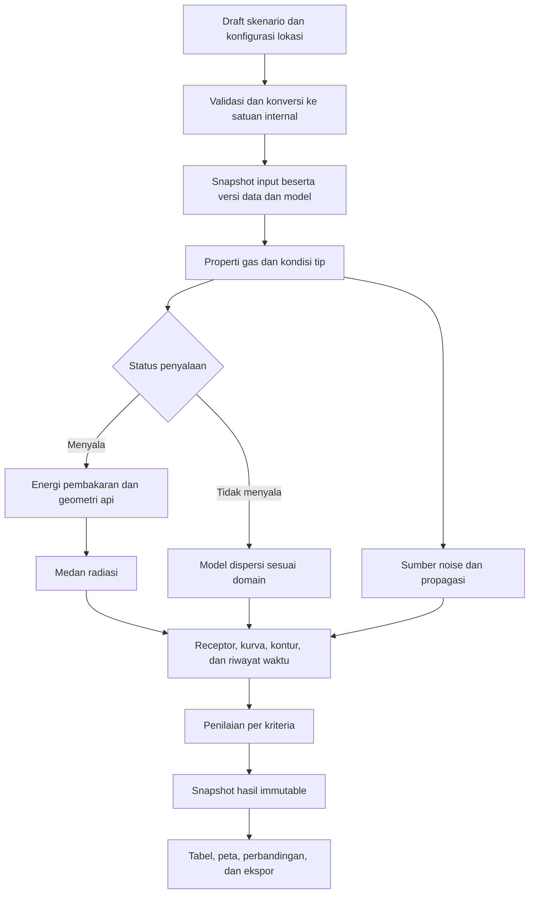

> Arsip historis sebelum pemilihan Python/backend dan cakupan penuh FERA–TOX. Spesifikasi aktif ada di [dokumen induk](../spesifikasi-sistem-fera-tox.md). Tautan relatif disesuaikan dengan lokasi arsip; isi keputusan lama bukan arahan runtime terkini.

# Konsep detail perbaikan Flare Radiation & Safety

**Status:** spesifikasi untuk dikerjakan kemudian; belum merupakan implementasi atau model yang tervalidasi.

**Basis evaluasi:** repository `arienug20/flare-radiation-safety`, commit `9dc2066ca1e71b5bebc44cf8733622df53853316`, 30 Oktober 2026.

Dokumen ini menetapkan perilaku yang dituju, kontrak antarbagian, persamaan dasar, batas dukungan, dan bukti yang harus tersedia sebelum hasil diterima. Urutan pengerjaan dan kriteria selesai terdapat di [backlog implementasi](./backlog-perbaikan-flare-2026-10-30.md).

## 1. Tujuan dan batas produk

Versi pertama yang diperbaiki ditujukan untuk **evaluasi konsekuensi radiasi elevated gas flare dengan kondisi sumber yang diketahui**. Hasil utamanya adalah fluks radiasi pada receptor, kurva dan kontur untuk ambang tertentu, serta penilaian terhadap kriteria yang dipilih.

Ruang lingkup awal yang disarankan:

| Aspek | Dukungan awal | Pengembangan berikutnya |
| --- | --- | --- |
| Sumber | Satu tip, gas satu fase, kondisi gas di tip diketahui | Beberapa sumber, source solver upstream, dua fase |
| Operasi | Kondisi tunak; satu laju alir representatif diberi label tunak | Riwayat blowdown dan perubahan status penyalaan |
| Lingkungan | Area terbuka, tanah datar, tanpa shielding | Bangunan, terrain, shielding, interaksi sumber |
| Api | Model radiasi sumber titik dengan geometri yang dapat ditelusuri | Distributed source atau solid flame jika diperlukan benchmark |
| Receiver | Koordinat dan elevasi eksplisit, orientasi penerimaan dinyatakan | Pergerakan receptor dan rute evakuasi |
| Hasil | Konsekuensi per skenario dan per kriteria | Dose, probabilitas cedera, dan agregasi risiko |

Ada dua tingkat kesiapan yang perlu dibedakan:

1. **Perhitungan dengan geometri diketahui:** kondisi tip dan geometri sumber radiasi berasal dari input atau kasus acuan. Tingkat ini menguji satuan, geometri, radiasi, contour extraction, serta pelaporan tanpa bergantung pada korelasi panjang api yang belum diverifikasi.
2. **Prediksi flare:** geometri api dihitung menggunakan korelasi terpilih yang sumber, edisi, satuan, rentang berlaku, dan hasil benchmark-nya sudah ditetapkan. Tingkat ini menjadi syarat sebelum mengklaim kemampuan prediksi flare pada domain tersebut.

PHAST adalah pembanding untuk konsekuensi yang sesuai dengan model dan kondisi kasusnya. Kesesuaian terhadap satu model PHAST tidak otomatis mencakup semua modulnya. SAFETI melibatkan frekuensi, probabilitas kejadian, cuaca, paparan, dan kerentanan untuk agregasi risiko; kemampuan itu ditempatkan sebagai pengembangan terpisah pada bagian 19.

## 2. Masalah awal yang harus ditutup

Pemeriksaan pada engine lama menemukan nitrogen murni menghasilkan panas pembakaran sekitar 76,2 MW pada input lain bawaan; flameout menghasilkan radiasi identik dengan operasi normal sekitar 125,4 MW; seluruh status kepatuhan bernilai `true`; serta receptor belum diteruskan ke engine. Tabel radiasi mengandalkan urutan object yang tidak cocok dengan urutan kriteria. Peta menghitung ulang fisika dengan konstanta berbeda. CSV memasangkan noise pada 501 m ke label jarak radiasi 101 m pada salah satu baris. Hasil lama juga tetap tersedia setelah input fisik diubah.

Fondasi baru harus menutup masalah tersebut sebelum hasil pembanding dipakai untuk menyetel model. Selisih antarproduk perlu dipisahkan dari kesalahan implementasi, perbedaan input, dan perbedaan model fisika.

Modul yang pengembangan fisikanya dijadwalkan kemudian tetap memerlukan penanganan awal: koreksi konversi konsentrasi sebelum dipakai, hapus penurunan IDLH dari LFL, dan hentikan klaim kepatuhan noise yang belum mempunyai dasar model. Jika belum dapat diperbaiki dalam paket awal, tampilkan modul tersebut sebagai belum didukung atau belum dinilai dan ringkasan sebagai parsial. Menunda pengembangan modul tidak membenarkan hasil lamanya terus dianggap valid.

## 3. Definisi skenario

Pisahkan tiga hal yang saat ini bercampur di `Scenario.type`:

- **Konteks operasi:** normal, emergency blowdown, planned shutdown, atau custom.
- **Fenomena/status penyalaan:** burning flare atau unignited release; flameout adalah kejadian yang memindahkan status penyalaan.
- **Kondisi sumber terhadap waktu:** tunak atau riwayat waktu yang diketahui.

| Kasus | Energi pembakaran nyala utama | Dispersi | Noise |
| --- | --- | --- | --- |
| Burning flare, bahan bakar tersedia | Dihitung dari energi bahan bakar dan model pembakaran | Emisi residu hanya jika ada model sumber residu yang sesuai | Sumber jet dan/atau pembakaran sesuai model |
| Flameout tanpa penyalaan berikutnya | Tidak ada nyala utama; kontribusi radiasi nyala utama nol | Aliran tidak terbakar masuk model dispersi yang didukung | Pelepasan gas dapat tetap bising |
| Emergency blowdown menyala | Gunakan riwayat kondisi tip jika tersedia | Sesuai cabang kejadian dan sumber residu yang dimodelkan | Mengikuti kondisi sumber terhadap waktu |
| Aliran inert murni | Tidak ada energi pembakaran dari aliran utama | Endpoint yang relevan memerlukan model sendiri | Dapat mempunyai noise pelepasan |
| Flow nol | Tidak ada kontribusi api/jet dari aliran utama | Tidak ada emisi dari aliran utama | Daya akustik sumber aliran utama nol |

Kontribusi pilot, steam/air assist, dan sumber lain hanya dimasukkan jika dinyatakan sebagai bagian model. Jangan memakai pilot sebagai alasan untuk memberi LHV bahan bakar pada gas inert. Ketidakadaan radiasi api tidak menyatakan bahwa seluruh jenis bahaya sudah dinilai.

Untuk burning flare, jangan otomatis memasukkan seluruh laju massa ke model dispersi gas tidak terbakar. Sumber residu memerlukan komposisi, laju massa, temperatur, dan basis konversi yang sesuai. Produk pembakaran seperti SO₂, bila relevan, merupakan spesies sumber tersendiri.

## 4. Arsitektur alur perhitungan



Engine tidak bergantung pada React atau Zustand. Modul UI mempersiapkan input, menjalankan engine, dan menampilkan hasil. Seluruh perhitungan spasial berasal dari evaluator yang sama. Komponen Plotly tidak menyimpan rumus fisika sendiri.

Kontrak fungsi konseptual:

```text
validateAndResolve(draft, projectContext) -> resolvedInput | diagnostics
computeGasProperties(composition, propertyDataset, state) -> GasProperties
resolveTipState(releaseDefinition, properties) -> SourceState
resolveFlame(source, combustion, weather, flameModel) -> FlameGeometry
evaluateRadiation(context, points, time) -> FieldSamples
evaluateDispersion(context, points, time) -> SpeciesConcentrations
evaluateNoise(context, receptors, time) -> AcousticResults
extractContours(field, criteria, plane, domain) -> ContourResults
assessCriteria(runOutputs, criteria, exposure) -> Assessments
assembleRun(inputSnapshot, outputs, versions) -> CalculationRun
```

Setiap fungsi mengembalikan hasil dan diagnosis yang terstruktur. Kegagalan satu modul tidak boleh diam-diam diganti dengan nol untuk menghasilkan ringkasan seolah lengkap.

## 5. Kontrak data

Gunakan versi skema proyek baru. Tabel berikut adalah kontrak konseptual; penamaan interface akhir boleh disesuaikan selama makna dan satuannya dipertahankan.

| Objek | Isi yang wajib tersedia |
| --- | --- |
| `ProjectDocument` | `schemaVersion`, identitas proyek, lokasi/datum, draft skenario, receptor, kriteria, referensi dataset/model, daftar run |
| `ScenarioDefinition` | Identitas, konteks operasi, status penyalaan, jenis sumber tunak/riwayat, komposisi, cuaca, pilihan model, dan parameter pembakaran yang relevan |
| `ReleaseDefinition` | Mode sumber, basis flow, kondisi gas di tip atau sumber upstream yang terpisah, geometri tip, dan mode performance/sizing |
| `GasProperties` | MW, LHV, densitas, Z, gamma jika diperlukan, kondisi evaluasi, versi dataset, dan provenance tiap properti |
| `SourceState` | Waktu, posisi tip, laju massa, T dan P absolut, fase, densitas, actual volume flow, area efektif, kecepatan, dan Mach bila tersedia |
| `FlameGeometry` | Model/versi, panjang dan dimensi yang diperlukan, posisi pangkal/pusat/arah api, serta status berlaku |
| `Receptor` | ID, nama, x/y/z, orientasi penerimaan, kategori penggunaan, dan kriteria yang diterapkan |
| `Criterion` | ID stabil, jenis besaran, nilai/satuan, operator, basis durasi/paparan, sumber/edisi dan konteks penggunaan |
| `CalculationRun` | ID run, waktu, input snapshot, hash input fisik, versi engine/model/dataset/kriteria, hasil tiap modul, diagnosis, dan status run |

Contoh pemisahan input sumber:

```ts
// Sketsa kontrak, bukan implementasi siap kompilasi.
type TipGeometryMode =
  | { kind: 'performance'; effectiveDiameterM: number }
  | { kind: 'initial_sizing'; targetMach: number };

type ReleaseDefinition =
  | { kind: 'known_tip_steady'; tipState: KnownTipInput; geometry: TipGeometryMode }
  | { kind: 'known_tip_history'; samples: TipInputSample[]; geometry: TipGeometryMode }
  | { kind: 'upstream_release'; sourceModel: ModelRef; upstream: UpstreamInput };
```

Mode yang belum diimplementasikan tetap dapat dikenali oleh skema, tetapi menghasilkan status `unsupported`; jangan diproses memakai rumus mode lain. Snapshot run menyertakan salinan data yang diperlukan agar perubahan katalog properti atau kriteria setelah run tidak mengubah arti hasil lama.

Jangan memakai nama properti ambigu seperti `pressure` tanpa basis atau `concentration` dengan komentar “mg/m³ atau ppm”. Nama dan metadata satuannya harus tunggal, misalnya `pressurePaAbs`, `temperatureK`, `massFlowKgS`, `concentrationMgM3`, dan `concentrationPpmV`.

## 6. Satuan dan validasi input

Sistem internal yang direkomendasikan:

| Besaran | Internal | Aturan pada batas UI/impor |
| --- | --- | --- |
| Massa dan flow | kg, kg/s | kg/hr dibagi 3.600; unit impor wajib diketahui |
| Temperatur | K | °C ditambah 273,15 |
| Tekanan | Pa absolut | barg memerlukan tekanan atmosfer untuk dikonversi |
| MW | kg/mol | g/mol atau kg/kmol harus dikonversi secara eksplisit |
| Energi spesifik | J/kg atau J/mol dengan nama berbeda | LHV dan HHV tidak saling menggantikan |
| Heat rate internal | W | Tampilan kW dibagi 1.000, MW dibagi 1.000.000 |
| Fluks | W/m² | kW/m² dikonversi pada batas output/input kriteria |
| Geometri dan waktu | m, s | Satu datum koordinat dan satu definisi waktu |
| Komposisi | Fraksi mol 0–1 | mol% dibagi 100, bukan fraksi massa |

Semua volume standar menyimpan `referenceTemperatureK`, `referencePressurePaAbs`, dan basis Z. Jangan menafsirkan `Nm³`, `Sm³`, atau `SCF` tanpa definisi referensi. Pilihan SI/Imperial hanya mengubah konversi input/tampilan; perhitungan dan snapshot canonical tetap memakai sistem internal.

Aturan validasi minimum:

- Semua nilai numerik harus finite. Field kosong dibedakan dari nol; hindari `value || default` untuk nilai yang boleh nol.
- Flow ≥ 0; diameter efektif > 0; suhu dan tekanan absolut > 0 serta berada dalam rentang properti/model yang digunakan.
- Komponen harus dikenal, tidak duplikat, dan fraksi mol tidak negatif. Total harus konsisten dengan satu. UI menawarkan normalisasi sebagai tindakan eksplisit dan menyimpan nilai sebelum/sesudahnya; engine tidak menormalisasi data tidak sah secara tersembunyi.
- Toleransi jumlah komposisi ditetapkan sebagai kebijakan numerik yang terdokumentasi. Angka toleransi tidak dipakai untuk menerima komposisi yang secara material berbeda dari 100%.
- Efisiensi dan fraksi energi berada di [0,1]. Z > 0. Gamma ideal-gas harus berasal dari data atau asumsi yang dinyatakan dan sesuai domain model.
- Angin tidak negatif; arah 360° dapat dinormalisasi menjadi 0°. RH 0% dan suhu 0°C adalah input sah jika model mendukungnya.
- Jangan mengubah angin tenang menjadi 0,5 m/s secara tersembunyi. Model yang tidak berlaku pada angin rendah mengembalikan diagnosis. Kasus tanpa angin dapat memakai geometri simetris jika model tersebut mendukungnya.
- Model sumber, fase, jenis gas, Mach, tekanan keluar, dan korelasi harus kompatibel. Nilai yang melewati domain tidak diperbaiki dengan clamp yang menghilangkan masalah fisik.

Validasi dilakukan saat input, saat impor, dan sebelum engine berjalan. Pesan menunjukkan field, sebab, dan cara mengatasinya.

## 7. Properti campuran dan kondisi tip

Untuk gas ideal dengan fraksi mol `yᵢ` dan MW komponen `Mᵢ` dalam kg/mol:

```text
M_mix = Σ(yᵢ Mᵢ)
wᵢ = yᵢ Mᵢ / M_mix
LHV_mix,mass = Σ(wᵢ LHVᵢ,mass)          [J/kg]
rho = P_abs M_mix / (Z R_u T)          [kg/m³]
R_u = 8,31446261815324                 [J/(mol K)]
```

Alternatif yang setara adalah mencampur entalpi pembakaran molar lalu membaginya dengan MW campuran. Data LHV volumetrik hanya boleh dikonversi jika basis volume referensinya diketahui. Hindari merata-ratakan LHV massal dengan fraksi mol.

`LHV = 0` pada campuran inert berarti tidak ada energi pembakaran bahan bakar utama. Properti yang belum tersedia berarti input/model belum lengkap. Kedua keadaan itu tidak diganti dengan LHV natural gas.

Untuk kondisi tip yang diketahui:

```text
Vdot_actual = mdot / rho
A_effective = pi D_effective² / 4
u_exit = Vdot_actual / A_effective
a_ideal = sqrt(gamma R_u T / M_mix)
Mach = u_exit / a_ideal
```

Relasi kecepatan suara di atas adalah baseline ideal-gas. Jika dipakai EOS real-gas, kecepatan suara harus berasal dari hubungan termodinamik yang konsisten; memasukkan Z ke rumus secara sembarang tidak cukup.

Dalam mode sizing awal:

```text
u_target = Mach_target × a
A_required = Vdot_actual / u_target
D_required = sqrt(4 A_required / pi)
```

Hasil sizing ini adalah ukuran area efektif awal, belum otomatis menjadi desain mekanik tip atau pemeriksaan lengkap kapasitas/backpressure. Tekanan header tidak boleh dipakai sebagai tekanan tip tanpa source calculation yang menjelaskan rugi tekanan dan ekspansi. Untuk flare terbuka subsonik, pendekatan tekanan tip mendekati atmosfer hanya digunakan sebagai asumsi eksplisit ketika sesuai; sumber choked atau berekspansi memerlukan model yang sesuai.

Komposisi, temperatur, dan tekanan boleh diterima sebagai hasil perhitungan eksternal dengan provenance. Implementasi v1 tidak perlu membangun solver upstream lengkap agar evaluasi radiasi dengan kondisi tip diketahui dapat digunakan dan diuji.

## 8. Energi pembakaran dan geometri api

Tetapkan definisi energi sebelum memilih radiative fraction:

```text
Q_available = mdot × LHV_mass           [W]
Q_combusted = eta_energy × Q_available  [W]
```

Efisiensi yang dimaksud harus merupakan fraksi konversi energi sesuai model. Destruction efficiency suatu spesies tidak otomatis sama dengan efisiensi energi total.

Ada dua basis radiative fraction yang mungkin dijumpai pada referensi:

```text
chi berbasis energi yang terbakar: Q_radiated = chi × Q_combusted
chi berbasis energi bahan bakar:   Q_radiated = chi × Q_available
```

Simpan basis yang digunakan. Jangan menerapkan faktor efisiensi dua kali jika korelasi sudah mengandung pengaruhnya. Energi radiasi harus konsisten dengan anggaran energi model yang dipilih. Pada no ignition, aliran inert, atau flow nol, kontribusi pembakaran dari aliran utama nol.

Geometri api menjadi output modul terpisah. Mode awal `specified_geometry` menerima pusat/arah atau dimensi api dari data acuan dan mencatat sumbernya. Mode prediktif menggunakan korelasi yang tercatat pada katalog model. Katalog mencantumkan:

- ID/versi, judul referensi, edisi, persamaan atau halaman;
- satuan setiap input, output, dan koefisien;
- kondisi fase, komposisi, jenis tip, bantuan steam/air, angin, dan rentang lain yang didukung;
- definisi panjang api, lift-off, tilt dan posisi pusat radiasi;
- data verifikasi dan hasil benchmark yang berlaku.

Koefisien `0.00336 × sqrt(Q_kJ/hr)` dan korelasi tilt lama tidak boleh dinyatakan benar atau diganti dengan koefisien baru sebelum sumber serta satuannya ditelusuri. Parameter geometri yang diimpor juga tidak disetel bebas per kasus hanya untuk mengejar satu angka radius.

## 9. Model radiasi dan koordinat

Baseline sumber titik untuk receiver normal terhadap arah datang radiasi:

```text
r = norm(receiverPosition - radiationCenter)
q_normal = tau_atm(path, weather) × Q_radiated / (4 pi r²)  [W/m²]
```

`chi` adalah fraksi energi yang diradiasikan; `tau_atm` adalah fraksi transmisi atmosfer sepanjang lintasan. Keduanya berbeda. Baseline transparan dapat memakai `tau_atm = 1` dengan asumsi itu ditampilkan. Korelasi transmisi yang lebih rinci harus mempunyai basis referensi dan domain, bukan faktor tetap yang diklaim mewakili semua cuaca.

Untuk receiver bidang dengan unit normal `n` yang menghadap sumber:

```text
s = (radiationCenter - receiverPosition) / r
q_plane = q_normal × max(0, dot(n, s))
```

Definisikan apakah keluaran PHAST yang dibandingkan adalah fluks normal terhadap sinar, fluks bidang tertentu, atau definisi lain. Receiver yang berada di dalam/dekat geometri api di luar validitas sumber titik diberi status yang sesuai; jangan menghindari singularitas dengan mengganti jarak memakai angka kecil tanpa dasar.

Pengembangan distributed source menjumlahkan kontribusi elemen dengan total daya radiasi yang tetap memenuhi anggaran energi. Solid flame memakai surface emissive power dan view factor yang konsisten dengan geometri serta orientasi receiver. Jika daya total sudah digunakan untuk menentukan emissive power, jangan mengalikan radiative fraction kembali pada tahap fluks.

Konvensi koordinat lokasi:

- x ke timur, y ke utara, z ke atas, semua dalam meter pada datum yang sama;
- pada v1, grade datar dapat ditetapkan z=0 dan posisi tip menyimpan elevasi aktual;
- arah angin meteorologis `theta` menyatakan arah asal, searah jarum jam dari utara;
- vektor downwind horizontal adalah `(-sin(theta), -cos(theta))` jika theta dalam radian;
- untuk perpindahan receptor `(dx,dy)`, koordinat downwind `xw = -dx sin(theta) - dy cos(theta)` dan crosswind `yw = dx cos(theta) - dy sin(theta)`.

Simpan kecepatan angin dan reference height. Profil angin seragam dapat menjadi asumsi awal yang eksplisit; profil terhadap ketinggian ditambahkan sesuai kebutuhan model. Jangan merotasi peta tanpa merotasi sumber, receptor, dan evaluasi field yang sama.

## 10. Kurva, kontur, dan definisi radius

Seluruh keluaran berikut memanggil evaluator yang sama: `q(x,y,z,t)`. Kurva memakai jalur sampling yang dinyatakan; kontur memakai bidang elevasi dan waktu tertentu; receptor memakai posisi aktualnya.

Algoritme kontur yang disarankan:

1. Tentukan bidang evaluasi, ambang, domain awal yang meliputi geometri dan receptor penting, serta resolusi.
2. Evaluasi field pada grid; tandai sel di luar validitas atau di dalam api secara eksplisit.
3. Ekstrak semua isopleth yang relevan, misalnya dengan marching squares, lalu refine daerah yang berubah cepat atau dekat ambang.
4. Periksa batas domain serta perilaku jauh dari sumber sesuai model. Perluas domain bila ambang masih terlampaui di batas atau sumber/geometri penting belum tercakup.
5. Ulangi pada grid lebih rapat untuk menilai konvergensi. Batas biaya komputasi boleh menghentikan proses, tetapi hasil diberi status `truncated` atau `unresolved`.
6. Simpan polygon, contour level, elevasi, waktu, resolusi, domain, serta status penemuannya.

Satu pencarian dari jarak jauh ke dekat tidak cukup untuk menggambarkan medan yang mempunyai puncak downwind atau lebih dari satu perpotongan. Pencarian kurva perlu mengembalikan interval exceedance dan semua crossing yang ditemukan. Kontur tidak harus berpusat di base flare.

Status contour minimal:

| Status | Makna dan tampilan |
| --- | --- |
| `closed` | Contour ditemukan dan domain mencukupi; tampilkan geometry dan extent |
| `no_exceedance` | Field valid berada di bawah ambang pada domain yang kecukupannya sudah diperiksa; tampilkan “ambang tidak terlampaui” |
| `touching` | Ambang hanya disentuh menurut model dan resolusi yang dinyatakan |
| `truncated` | Contour masih melewati batas domain; tampilkan batas bawah extent, bukan radius final |
| `unresolved` | Resolusi atau solver belum memadai; jangan mengubahnya menjadi nol |
| `not_applicable` | Modul tidak berlaku pada skenario ini, misalnya radiasi nyala utama saat no ignition |

Jika ringkasan radius tetap diperlukan, definisikan sebagai **jarak horizontal maksimum dari base yang dipilih ke daerah exceedance pada elevasi, waktu, dan kriteria tertentu**. Ini adalah envelope geometris. Jangan menyamakan radius downwind dengan jarak miring dari pusat api.

Contoh verifikasi analitik: untuk sumber titik pada `(xc,yc,zc)`, `tau=1`, receiver normal terhadap sinar, dan bidang `z=z0`, contour `q=q_limit` berbentuk lingkaran apabila:

```text
rh² = Q_radiated / (4 pi q_limit) - (zc-z0)² > 0
pusat lingkaran = (xc,yc)
radius terhadap pusat lingkaran = sqrt(rh²)
```

Jika `rh² < 0`, tidak ada exceedance pada bidang tersebut. Jika base berada di `(0,0)`, extent maksimum contour adalah `sqrt(xc²+yc²) + rh`. Gunakan satuan W dan W/m² secara konsisten pada persamaan ini.

## 11. Receptor dan kriteria penilaian

Gunakan ID kriteria stabil. Dua kriteria dapat memakai fluks yang sama, misalnya untuk konteks paparan berbeda, tetapi tetap mempunyai identitas dan dasar penggunaan masing-masing. UI tidak mengambil radius lewat indeks `Object.values`.

Objek kriteria menyimpan:

```text
id, revision, label, metric, threshold, unit, comparisonOperator
applicableReceptorCategories, exposureBasis, duration/averagingPeriod
sourceTitle, edition/reference, jurisdiction/siteBasis, notes
```

Perbandingan pada receptor harus berupa besaran yang sepadan: fluks dengan batas fluks, noise dengan batas noise beserta periode yang sesuai, konsentrasi spesies dengan endpoint spesies. Kriteria jarak minimum adalah jenis pemeriksaan tersendiri; jarak tidak dibandingkan dengan batas fluks.

Status penilaian: `within_criterion`, `exceeds`, `not_assessed`, atau `not_applicable`. Ketidakpastian numerik dekat batas dapat diberi flag `near_limit` tanpa menyembunyikan nilai dan arah selisih. Tidak ada default PASS. Penilaian memerlukan model yang berlaku, input lengkap, dan kriteria yang relevan. Jika model baru sebatas screening, hasil penilaian tetap ditandai sebagai screening.

Untuk paparan transien, gunakan riwayat receptor. Dose dapat ditulis `D = integral(q(t)^n dt)`, tetapi eksponen, unit, koefisien probit, perlindungan, serta durasi berasal dari model kerentanan yang dipilih. Jangan memakai sebuah batas fluks tunak sebagai pengganti model cedera atau probabilitas fatalitas.

Ringkasan antarbahaya mempertahankan hasil radiasi, dispersi, dan noise masing-masing. Envelope gabungan hanya dibuat jika seluruh geometry, origin, kriteria, waktu, dan status cakupan diketahui. Modul wajib yang belum tersedia menghasilkan ringkasan parsial, bukan “overall safe radius” lengkap.

## 12. Status run, provenance, dan hasil yang kedaluwarsa

Pisahkan status proses dari hasil fisik:

| Dimensi | Contoh status |
| --- | --- |
| Proses run | `queued`, `running`, `completed`, `partial`, `failed`, `cancelled` |
| Hasil modul | `computed`, `not_applicable`, `unsupported`, `invalid_input`, `failed` |
| Validitas model | `within_domain`, `outside_domain`, `undetermined` |
| Keadaan draft terhadap run | `current`, `stale`, `no_run` |
| Status contour/kriteria | Mengikuti bagian 10 dan 11 |

Nilai nol hanya disimpan ketika memang merupakan hasil fisik yang diketahui. Kontribusi sumber akustik nol disimpan sebagai daya nol atau sumber tidak aktif; jangan menserialisasi `log10(0)` sebagai `-Infinity`. Nilai yang belum dihitung memakai state eksplisit, bukan nol. NaN dan Infinity harus menjadi diagnosis sebelum ekspor.

Setiap run menyimpan sekurangnya:

```text
runId, createdAt, inputSnapshot, inputHash
engineVersion, modelIdsAndVersions, propertyDatasetVersion, criteriaRevision
sourceStates, intermediateQuantities, outputs, diagnostics, validity
```

`inputHash` mencakup semua input yang memengaruhi perhitungan dan penilaian: komposisi, kondisi sumber, cuaca, receptor, kriteria, model, dan versi data. Gunakan serialisasi canonical dan hash yang stabil. Nama tampilan proyek tidak perlu membuat field fisika kedaluwarsa; perubahan kriteria atau receptor harus membuat penilaian terkait kedaluwarsa. Pada implementasi awal, invalidasi satu run penuh dapat dipakai untuk menjaga kesederhanaan.

Aturan siklus hidup:

1. Pengguna mengedit draft. Hasil terdahulu tetap boleh dilihat sebagai snapshot lama dengan tanda kedaluwarsa.
2. Tombol Run memvalidasi dan membuat snapshot, kemudian menjalankan engine terhadap snapshot itu.
3. Hasil worker membawa request ID serta input hash. Jika draft berubah selama kalkulasi, hasil lama tidak boleh menggantikan current run draft baru.
4. Compare, peta dan report memilih run secara eksplisit. Jangan menghitung ulang diam-diam di satu panel sementara panel lain memakai cache.
5. Ekspor menggunakan input snapshot run; perubahan draft tidak boleh mengubah input yang dicetak bersama hasil lama.

Provenance properti dan korelasi mencatat apakah berasal dari literatur, vendor, pengguna, synthetic fixture, atau legacy. Versi/konten yang digunakan harus bisa ditelusuri, bukan hanya URL ke tabel yang dapat berubah.

## 13. Perubahan alur antarmuka

Alur yang direkomendasikan: **Proyek dan basis → Skenario → Sumber dan komposisi → Cuaca → Receptor dan kriteria → Model → Run → Hasil → Laporan**.

| Panel | Perilaku yang dituju |
| --- | --- |
| Proyek | Menyimpan datum, basis satuan, identitas studi, serta sumber referensi |
| Skenario | Memisahkan konteks operasi, ignition state, steady/history, dan jenis sumber |
| Sumber | Memperjelas header versus tip; pilihan diameter diketahui atau sizing; input yang tidak relevan disembunyikan/dinonaktifkan |
| Properti | Menampilkan komposisi, basis LHV, kondisi properti, dan data yang masih kurang |
| Cuaca | Menampilkan reference height serta konvensi arah angin dan parameter yang dipakai model |
| Receptor | Menggunakan koordinat/elevasi aktual dan kriteria terpilih; marker peta berhubungan dengan baris hasil yang sama |
| Model | Pilihan model, asumsi penting dan domain penggunaan yang memengaruhi keputusan pengguna |
| Hasil | Memisahkan intermediate source/flame, nilai receptor, contour, status penilaian, dan keterbatasan cakupan |
| Compare | Membandingkan run pada metrik yang sama; menandai input/model yang berbeda serta run kedaluwarsa |
| Report | Memakai snapshot run yang dipilih dan dapat ditelusuri kembali |

Peta menampilkan base, posisi tip/proyeksi api, arah angin, receptor, elevasi bidang evaluasi, satuan warna, serta status contour. Tampilan elevation menggunakan tinggi aktual. Receptor, grid, dan kurva yang menunjuk lokasi sama menghasilkan nilai dari evaluator yang sama; interpolasi tampilan, jika dipakai, diberi batas galat yang sesuai.

Hindari warna hijau yang berarti “aman” ketika model belum menghitung suatu bahaya. Label yang berguna adalah “belum dihitung”, “input berubah”, “model tidak mendukung kondisi ini”, atau “ambang tidak terlampaui pada bidang yang dinilai”.

## 14. Format laporan dan ekspor

Laporan minimum memuat identitas proyek/run, waktu, versi engine/model, seluruh input yang berpengaruh, basis satuan, komposisi, kondisi sumber, model dan asumsi, receptor/kriteria, intermediate penting, hasil dan diagnosis.

Pakai dua jenis CSV:

1. **Ringkasan receptor:** satu baris per run–scenario–time–receptor–metric–criterion. Sertakan value, unit, threshold, assessment status, dan module validity.
2. **Field sampling:** satu baris per run–time–metric–species bila relevan–x–y–z–value–unit. Sertakan model dan status sampling. Grid yang berbeda tidak digabungkan berdasarkan indeks array.

Contoh header konseptual field sampling:

```csv
run_id,scenario_id,time_s,metric,species_id,x_m,y_m,z_m,value,unit,module_status
```

Jika format lebar diperlukan, seluruh metric harus dievaluasi pada koordinat bersama yang dinyatakan. Jangan memasangkan kurva jarak radiasi dan noise yang kebetulan memiliki indeks sama.

File proyek JSON menyimpan `schemaVersion`, draft, dan metadata run. Data grid besar dapat disimpan sebagai lampiran atau cache di IndexedDB setelah kebutuhan ukuran diukur. Nilai sumber perhitungan disimpan tanpa pembulatan presentasi. Jika ekspor disebut PDF, hasilnya harus benar-benar PDF; pilihan TXT tetap dapat dipertahankan dengan label yang sesuai.

## 15. Riwayat waktu dan blowdown

Tahap awal transien menerima hasil source calculation atau data operasi berupa sampel waktu, mdot, T dan P tip. Komposisi boleh konstan pada versi awal; asumsi ini dicatat. Tekanan header dan persediaan upstream tidak otomatis memberi riwayat tip tanpa model blowdown.

Aturan numerik:

- Waktu terurut ketat, tidak duplikat, dan intervalnya dinyatakan. Flow tidak negatif; interpolasi antar titik diketahui dan terdokumentasi.
- Pada evaluasi performa, geometri tip tetap selama run. Jika sizing terhadap riwayat, hitung kebutuhan area tiap kondisi yang relevan dan pilih satu area yang memenuhi target, kemudian evaluasi ulang semua kondisi menggunakan area tetap tersebut.
- Integrasikan massa keluar dengan interval waktu sebenarnya. Jika inventory tersedia, lakukan pemeriksaan mass balance.
- Untuk pendekatan quasi-steady, hitung properti, geometri, dan field pada setiap waktu. Nyatakan bahwa dinamika api tidak otomatis mengikuti perubahan sumber seketika; rentang penggunaan pendekatan memerlukan pemeriksaan.
- Peristiwa ignition/flameout menjadi breakpoint eksplisit. Jangan melakukan interpolasi energi pembakaran melintasi perpindahan status tanpa definisi model.
- Ringkas peak flux per receptor, waktu puncak, durasi exceedance, dan dose jika modelnya dipilih. Waktu peak flow, peak flux, dan extent maksimum tidak diasumsikan sama.
- Peta `max over time` adalah envelope berbagai waktu; labeli agar tidak dianggap sebagai kejadian serentak pada satu waktu.

## 16. Pengembangan dispersi dan toksisitas

Gaussian plume hanya dipakai dalam domain passive dilute plume yang sesuai dengan asumsi angin, turbulensi, dan kondisi sumbernya. Near-field jet, buoyancy kuat, dense gas, flashing, dua fase, serta calm wind memerlukan model lain atau status tidak didukung.

Baseline Gaussian dengan sumber massa tunak dan refleksi tanah sempurna:

```text
C(x,y,z) = mdot / (2 pi u sigma_y sigma_z)
           × exp(-y²/(2 sigma_y²))
           × [exp(-(z-H)²/(2 sigma_z²)) + exp(-(z+H)²/(2 sigma_z²))]
```

Dengan input SI, C dalam kg/m³. Koefisien sigma, stability class, averaging time, roughness dan definisi effective height harus mengikuti referensi model. Pada model adveksi downwind ini, domain x>0 ditangani secara eksplisit; peta tidak boleh memakai jarak radial untuk membentuk plume simetris ke segala arah.

Flammability dan toksisitas adalah keluaran terpisah:

- Untuk campuran bahan bakar yang memenuhi asumsi Le Chatelier, gunakan fraksi mol bahan bakar dan LFL komponen dengan satuan fraksi volume yang konsisten. `LFL_mix = 1 / sum(y_i/LFL_i)` berlaku untuk basis campuran yang didefinisikan dan asumsi modelnya.
- Bila komposisi mengandung inert, nyatakan apakah LFL dihitung untuk fuel-only mixture atau konsentrasi seluruh stream. Normalisasi komponen combustible saja mengubah basis. Pengaruh inert terhadap flammability tidak boleh diselesaikan hanya dengan mengganti nama hasil fuel-only; gunakan model/rujukan campuran yang sesuai.
- `ppmV = vol% × 10000`; pada basis 25°C, 1 atm dan pendekatan ideal, `mg/m³ = ppmV × MW_g/mol / 24,45`. Pada basis T/P berbeda, gunakan volume molar yang sesuai.
- Konsentrasi spesies dari field massa campuran memakai fraksi massa spesies, bukan fraksi mol secara langsung.
- IDLH adalah endpoint spesifik bahan dengan referensi dan konteksnya. Jangan menghitungnya sebagai 10% LFL. Endpoint lain juga menyimpan basis durasi yang relevan.
- Campuran multikomponen toksik memerlukan aturan kombinasi yang mempunyai dasar; satu persentase LFL tidak mewakili toksisitas H₂S atau CO.

Peta, kurva dan receptor dispersi berasal dari evaluator dispersi yang sama. Semua input sumber dan cuaca diteruskan; tidak ada konstanta tersembunyi 1 kg/s, 5 m/s, tinggi 30 m, atau kelas D yang menggantikan skenario.

## 17. Pengembangan noise

Pisahkan estimasi **sound power sumber** dari **sound pressure pada receptor**. Daya sumber berasal dari data vendor, pengukuran, atau korelasi yang terdokumentasi pada domain flow/pressure/tip yang sesuai.

Baseline bentuk propagasi per band frekuensi:

```text
Lp_band = Lw_band + directivity - A_div - A_atm - A_ground - A_barrier - A_misc
A_div ≈ 20 log10(r / 1 m) + 11 dB      [untuk basis spreading yang sesuai]
Lp_A = 10 log10(sum(10^((Lp_band + A_weight_band)/10)))
```

Gunakan jarak tiga dimensi dari sumber ke receptor. Aturannya harus konsisten dengan definisi sumber, directivity, dan perlakuan tanah agar tidak dihitung ganda. Absorpsi atmosfer membutuhkan band frekuensi serta T, RH, dan tekanan sesuai metode; koefisien dB/km tidak boleh dianggap dB/m.

Noise jet dapat tetap ada saat flameout; combustion noise tidak otomatis ada. Pada flow nol, kontribusi akustik aliran utama nol. Jika background noise disertakan, gabungkan secara energi dan catat sumber pengukurannya.

Batas noise menyimpan periode penilaian, kategori penggunaan lahan/pekerja, dan acuan yang berlaku. Benchmark noise dapat berasal dari vendor atau pengukuran; jangan mengasumsikan PHAST menyediakan pembanding yang sesuai untuk modul ini.

## 18. Contoh acuan matematika untuk implementasi

Contoh ini sengaja memakai properti dan geometri yang ditetapkan, **bukan** prediksi korelasi flare atau benchmark PHAST.

| Input | Nilai |
| --- | --- |
| Gas | Metana murni, MW 0,016043 kg/mol |
| Kondisi tip | T=313,15 K; P=101.325 Pa absolut; Z=1; gamma=1,3 |
| Flow dan diameter efektif | 1 kg/s; 0,5 m |
| LHV yang ditetapkan | 50.000.000 J/kg |
| Efisiensi energi dan chi | 0,98 dan 0,20; chi berbasis energi yang terbakar |
| Pusat sumber radiasi | (10, 0, 20) m |
| Atmosfer dan receiver | tau=1; normal terhadap arah datang radiasi |
| Bidang contour | z=0; base acuan (0,0) |

Hasil yang diturunkan dari persamaan bagian 7–10:

| Besaran | Hasil perkiraan |
| --- | --- |
| Densitas gas | 0,624331999 kg/m³ |
| Actual volume flow | 1,601711911 m³/s |
| Kecepatan tip | 8,157451777 m/s |
| Kecepatan suara ideal | 459,327222356 m/s |
| Mach | 0,0177595653 |
| Energi tersedia / terbakar / diradiasikan | 50.000 / 49.000 / 9.800 kW |
| Fluks pada receptor (100,0,0) m | 0,091748144 kW/m² |
| Fluks maksimum pada bidang tanah | 1,949648053 kW/m², pada (10,0,0) |
| Radius contour 1,58 kW/m² terhadap pusat contour | 9,673767908 m |
| Extent maksimum contour tersebut dari base | 19,673767908 m |

Contoh ini memeriksa unit, source state, anggaran energi, posisi sumber, dan perbedaan radius contour terhadap extent dari base. Bila hasil berbeda, temukan penyebab aritmetika atau definisi input sebelum menggunakan korelasi api yang lebih kompleks.

Versi data yang dapat dipakai untuk menyiapkan uji implementasi tersedia di [contoh kasus analitik JSON](../contoh-kasus-analitik.json). Nilai dalam JSON menggunakan unit yang tercantum pada nama field; output internal fluks dalam W/m² berbeda faktor 1.000 dari tabel tampilan kW/m² di atas.

## 19. Pengembangan risiko jika sasaran akhirnya SAFETI

Data tambahan yang diperlukan mencakup sumber frekuensi kejadian, event tree, probabilitas immediate/delayed ignition, distribusi cuaca, populasi/occupancy, model kerentanan, dan seluruh konsekuensi yang relevan terhadap studi.

Bentuk konseptual individual risk pada lokasi:

```text
IR_location(p) = sum(f_s × P_branch_given_s × P_weather_given_branch
                     × P_fatality_at_p_given_s_branch_weather)
```

Frekuensi `f_s` mempunyai satuan per tahun. Peluang cabang dan cuaca harus kondisional secara konsisten dan tidak dihitung ganda. Location-specific individual risk biasanya mempunyai asumsi kehadiran yang ditetapkan; memasukkan occupancy pekerja mengubah definisi dan harus disebutkan. Societal risk memerlukan populasi serta distribusi jumlah korban; bentuknya `F(N)=sum(nu_j × P(N_j ≥ N))`, dengan cabang kejadian yang benar.

Kontur kW/m², probability of fatality untuk satu kejadian, dan risiko per tahun adalah metric yang berbeda. Jangan membangun kontur risiko hanya dengan mengganti warna contour radiasi. Implementasi risiko menunggu domain dan validasi modul konsekuensinya, termasuk jenis bahaya lain yang memang dibutuhkan studi.

## 20. Benchmark, ketidakpastian, dan penerimaan model

Satu kartu benchmark menyimpan versi PHAST, identitas model, definisi sumber, komposisi/basis, fase, T/P, flow/time history, diameter, geometri, weather/reference height, parameter pembakaran, transmissivity, receiver/orientasi, kriteria dan keluaran yang dibandingkan. Semua default yang memengaruhi hasil ikut dicatat.

Urutan diagnosis: **basis input → source state → energi → geometri → transmisi/orientasi → fluks receptor → contour → penyajian**. Perbandingan dimulai pada intermediate quantities, bukan hanya “safe radius”.

Rancang cakupan awal sekitar 10–20 kasus yang bervariasi dalam flow, diameter, komposisi, tinggi, angin, dan posisi receptor; jumlah ini merupakan rencana awal, bukan jaminan validasi. Pisahkan kasus untuk kalibrasi dari kasus pemeriksaan yang tidak dipakai untuk menyetel parameter. Simpan versi dataset benchmark.

Kriteria penerimaan yang direkomendasikan:

- Persamaan analitik dan konversi satuan memiliki hasil referensi independen; target relatif `1e-6` dapat dipakai untuk operasi numerik yang sesuai, dengan batas absolut dekat nol.
- Receptor, field, kurva, dan ekspor pada input/koordinat sama menggunakan evaluator yang sama. Perbedaan karena sampling/interpolasi harus berada dalam batas yang dinyatakan.
- Target awal konvergensi contour/field utama: perubahan di bawah 1% setelah pemadatan grid/perluasan domain yang relevan; sesuaikan bila sifat model memerlukannya.
- Benchmark PHAST melaporkan bias, galat absolut/relatif, RMSE, galat maksimum, selisih extent, dan salah klasifikasi exceedance. Toleransi lintas model ditetapkan per metric dan domain setelah model pembanding dipastikan; tidak ada janji satu angka persentase untuk seluruh kondisi.
- Kasus dekat nol atau tanpa crossing mempunyai penilaian khusus agar tidak terjadi pembagian nol atau radius fiktif.
- Analisis sensitivitas mencakup parameter yang mempunyai dasar variasi, misalnya flow, chi, angin, atau geometri. Kombinasi parameter harus tetap mungkin secara fisik; rentang sensitivitas bukan confidence interval statistik tanpa model probabilitas.

Pisahkan ketidakpastian input, ketidakpastian model, dan galat numerik. Kecocokan terhadap PHAST menguji kesesuaian terhadap pembanding itu; data eksperimen atau vendor dibutuhkan bila tersedia untuk menilai ketepatan fisik secara independen.

## 21. Migrasi dari proyek lama

Migrasi harus mempertahankan file asli dan hasil lama sebagai data arsip, lalu membuat dokumen versi baru. Jangan menimpa file pengguna atau menyatakan hasil legacy tetap current setelah engine berubah.

| Field/perilaku lama | Perlakuan pada migrasi |
| --- | --- |
| `flowRate` kg/hr | Konversi eksplisit menjadi kg/s; simpan nilai dan unit asli |
| `gasComposition.molPercent` | Konversi ke fraksi mol dan validasi komponen/total |
| `type=flameout` | Status unignited release dan tag kejadian flameout |
| `type=emergency_blowdown` tanpa history | Konteks blowdown dengan input tunak representatif; jangan membuat riwayat waktu fiktif |
| `fluidPressure` dan `fluidTemperature` | Tandai basis header/tip perlu ditinjau; jangan otomatis menganggap kondisi tip |
| `tipDiameter=0` dan Mach | Calon mode sizing; perlu kondisi tip dan properti yang sah sebelum diterima |
| Fraction radiated/efficiency | Pertahankan nilai asli dan tandai basis energi perlu dipastikan |
| Tabel properti lama | Pertahankan dataset snapshot sebagai legacy, dengan status sumber/verifikasi yang sebenarnya |
| `results` dan `compliant` lama | Arsipkan sebagai legacy, tandai tidak current, dan jangan dipakai untuk penilaian baru |
| Active scenario di dua lokasi state | Tentukan satu sumber kebenaran dan pastikan ID menunjuk skenario yang masih ada |
| Pilihan Imperial lama | Jangan menganggap angka lama sudah dikonversi; gunakan metadata/basis aktual atau tandai perlu peninjauan |

Pengguna harus bisa membuka dokumen lama, melihat field yang perlu dilengkapi, dan menyimpan salinan versi baru. File tidak valid memberikan diagnosis field yang jelas. Migrasi ulang dokumen yang sudah bermigrasi tidak boleh mengonversi unit untuk kedua kalinya.

## 22. Struktur kode dan urutan kerja teknis

Struktur tujuan yang dapat dikerjakan bertahap:

```text
src/domain/                 skema input, result, status, criterion, migrasi
src/engine/units/            konversi dan canonical input
src/engine/properties/       properti komponen/campuran dan provenance
src/engine/source/           known-tip state, performance, initial sizing
src/engine/combustion/       energi dan geometri api
src/engine/radiation/        evaluator medan
src/engine/geometry/         koordinat, sampling, contour dan extent
src/engine/assessment/       penilaian receptor/kriteria
src/engine/dispersion/       fase pengembangan berikutnya
src/engine/acoustics/        fase pengembangan berikutnya
src/engine/run/              orkestrasi run dan snapshot
src/workers/                 worker jika profiling menunjukkan kebutuhan
src/reporting/               serialisasi dan ekspor dari snapshot run
tests/reference/             contoh analitik independen
tests/benchmarks/            kasus PHAST/vendor dengan metadata
```

Struktur ini adalah arah pemisahan tanggung jawab; folder boleh digabung pada tahap awal agar proporsional. Pertahankan TypeScript/Next.js. Backend atau perpindahan bahasa belum menjadi prasyarat untuk baseline perhitungan ini.

Pilihan teknis yang disarankan: validator runtime untuk file/input, test runner TypeScript untuk modul murni, serta beberapa uji alur UI untuk perubahan input–run–stale–ekspor. Golden result tidak disalin begitu saja dari engine yang sedang diuji. Gunakan satu package manager dan lockfile yang dipilih, versi runtime yang dicatat, konfigurasi Next.js yang tidak ambigu, serta CI lint, typecheck, uji engine, dan build.

Kerjakan perubahan kecil yang dapat diperiksa sesuai [backlog](./backlog-perbaikan-flare-2026-10-30.md). Jangan menggabungkan perubahan rumus, satuan, geometri, dan tuning parameter pembanding dalam satu perubahan besar yang menghilangkan jejak penyebab selisih. Definisi selesai adalah kemampuan yang dapat ditunjukkan lewat kasus acuan, status validitas yang benar, dan hasil antarpanel yang konsisten.

## 23. Referensi pengguna yang ditambahkan setelah konsep awal

[Telaah Dispersion Study TOX 2023](../telaah-referensi-phast-tox-2023.md) mencatat penggunaan Phast 8.4 yang terlihat pada gambar, enam kasus exhaust/flameout, tiga cuaca, dan 57 baris hasil historis. Referensi ini memperjelas kebutuhan buoyancy/plume rise, kemungkinan perilaku dense gas, serta konsentrasi dan kontur terhadap elevasi.

Referensi tersebut merupakan acuan dispersi/toksisitas, bukan benchmark langsung radiasi elevated flare. Ada perbedaan averaging dan beberapa konflik data internal yang harus direkonsiliasi sebelum dijadikan nilai penerimaan. Untuk mencakup studi TOX, tipe sumber exhaust dan acid-gas vent perlu dibedakan dari elevated flare. PDF FERA asli yang turut diberikan belum terbaca karena batas transfer 32 MiB; informasi FERA pada paragraf berikut berasal dari versi Markdown yang kemudian diberikan pengguna.

Versi Markdown FERA kemudian berhasil diakses. [Telaah referensi FERA 2026](../telaah-referensi-fera-2026.md) mencatat PHAST 9.0, UDM, TNO Multi-Energy, input inventori/discharge, dan keluaran numerik non-CFD pada Lampiran 7. Ini memperjelas cabang accidental release dan impairment frequency; kasus jet fire kebocoran tidak otomatis menjadi benchmark flare performance. Tabel yang terfragmentasi, parameter roughness yang berbeda, dan override studi yang tidak dicakup summary report perlu direkonsiliasi. Telaah tersebut memakai teks Markdown, bukan verifikasi gambar PDF asli.
