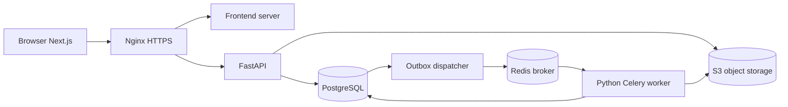
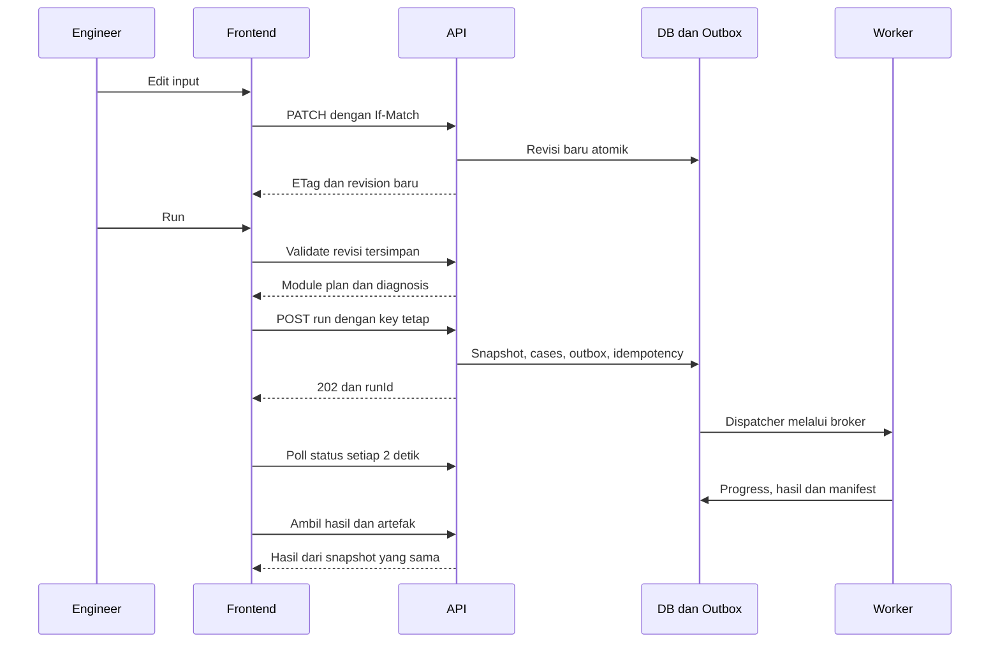

# Spesifikasi sistem FERA–TOX

**Versi dokumen:** 1.0, 31 Oktober 2026. **Status:** spesifikasi implementasi, bukan pernyataan bahwa backend atau model di bawah sudah tersedia/tervalidasi.

**Basis repository:** `arienug20/flare-radiation-safety`, baseline evaluasi `9dc2066ca1e71b5bebc44cf8733622df53853316`. Pada baseline, perhitungan berada di browser, penyimpanan memakai localStorage, dan belum ada API/database/worker. Dokumen ini menggantikan keputusan arsitektur frontend-only pada konsep awal.

Kata **wajib** menyatakan kontrak yang harus dipenuhi implementasi. Nilai contoh API adalah kontrak target setelah implementasi, bukan respons layanan yang sudah berjalan. Waktu operasional disimpan dalam UTC; tampilan mengikuti timezone pengguna, default Asia/Jakarta.

## 1. Keputusan dan batas sistem

| Aspek | Keputusan |
| --- | --- |
| Cakupan | Elevated flare, accidental release, jet fire, dispersi TOX/acid gas, toksisitas, flash fire, pool fire, VCE, frekuensi impairment, dan noise |
| Engine | Mandiri, Python 3.12; PHAST adalah pembanding eksternal dan bukan dependensi runtime |
| Frontend | Next.js, React, TypeScript, Plotly; Zustand untuk UI/draft, TanStack Query untuk state server |
| API | FastAPI, Pydantic v2, OpenAPI; prefix `/api/v1`; satu origin HTTPS |
| Numerik | NumPy, SciPy; adapter properti `thermo`, Peng–Robinson sebagai baseline real-gas, ideal-gas untuk domain terbatas/verifikasi |
| Data | PostgreSQL 16, SQLAlchemy 2, Alembic; object storage kompatibel S3, MinIO sebagai pilihan Compose lokal |
| Job | Celery 5, Redis 7 broker, dispatcher transactional outbox; PostgreSQL menyimpan status authoritative |
| Pengguna | Tim internal, akun lokal; project owner/editor/viewer; admin sistem mengelola akun |
| Laporan | Ekspor langsung dari run, tanpa reviewer, approver, tanda tangan, atau alur approval |
| Deployment | Docker Compose/VPS dan Nginx; konfigurasi Cloudflare lama bukan target deployment rancangan ini |
| CFD | Studi khusus bila domain kasus membutuhkannya; bukan bagian baseline engine |

Individual risk dan F–N societal risk bukan sinonim impairment frequency. Ekstensi ke QRA tersebut membutuhkan spesifikasi tambahan. Template output PHAST yang menyebut fireball tidak otomatis menetapkan fireball sebagai outcome kredibel pada setiap studi.

Semua modul dicakup dalam desain, tetapi diaktifkan bertahap setelah referensi dan validasinya tersedia. Model yang belum siap wajib dikenali dan ditolak dengan `MODEL_NOT_READY`, bukan diganti rumus sederhana dengan nama yang sama.

## 2. Arsitektur dan tanggung jawab



| Komponen | Tanggung jawab | Batas |
| --- | --- | --- |
| Browser | Input, unit tampilan, validasi bentuk, peta/kurva dan polling | Tidak mempunyai versi kedua rumus fisika |
| API | Auth, membership, validasi, revisi, snapshot, idempotensi dan akses hasil | Tidak menjalankan kalkulasi studi panjang di HTTP request |
| Dispatcher | Mengirim outbox ke broker dan memulihkan publikasi gagal | Tidak menyatakan komputasi selesai setelah publish |
| Worker | Memuat snapshot, menjalankan engine, menulis hasil dan diagnosis | Tidak membaca draft yang berubah selama run |
| PostgreSQL | Revisi, metadata, lease job, hasil ringkas, status dan provenance | Tidak menyimpan seluruh grid besar sebagai kolom inline |
| Object storage | Artefak immutable dan checksum | Tidak terbuka untuk akses anonim |
| Engine | Fungsi numerik dengan input/output bertipe, tanpa dependency UI | Tidak menebak properti/korelasi yang hilang |

API dan worker memakai image backend, dependency lock, dan versi engine yang sama. Redis bukan sumber kebenaran hasil. Restart browser, API atau Redis tidak boleh menghilangkan run yang sudah committed di database.

## 3. Satuan, koordinat, dan kontrak input

### 3.1 Satuan canonical

| Besaran | Internal | Aturan |
| --- | --- | --- |
| Massa, flow, waktu | kg, kg/s, s | kg/hr dibagi 3600; timestamp bukan durasi |
| Temperatur | K | °C + 273,15; °F dikonversi melalui °C |
| Tekanan proses | Pa absolut | Gauge + tekanan atmosfer pada datum yang diketahui |
| Overpressure | Pa gauge | Field berbeda dari tekanan absolut; tidak ditambahkan atmosfer saat menilai blast |
| MW | kg/mol | g/mol dibagi 1000 |
| Energi, heat rate, flux | J, J/kg atau J/mol, W, W/m² | Nama field membedakan basis; tampilan kW/kW/m² dibagi 1000 |
| Geometri | m, rad untuk fungsi trigonometrik | Sudut input arah angin tetap dinamai `windFromDeg` |
| Komposisi | Fraksi mol 0–1 | mol% dibagi 100; fraksi massa dihitung terpisah |
| Konsentrasi | kg/m³ di field massa; ppmV/mg/m³ sebagai metric eksplisit | Tidak ada field dengan unit “mg/m³ atau ppm” |
| Frekuensi | kejadian/tahun | Tahun statistik diidentifikasi pada dataset; bukan Hz |

Flow volumetrik standar wajib mempunyai `referenceTemperatureK`, `referencePressurePaAbs` dan basis Z. MMSCFD, Nm³ dan Sm³ tidak saling menggantikan tanpa reference condition. Nilai sumber disimpan tanpa pembulatan presentasi.

### 3.2 Kerangka koordinat

Satu proyek memakai koordinat lokal ENU: x timur, y utara, z elevasi terhadap datum lokal. Grade awal datar `z=0`; tip/receptor tetap menyimpan elevasi absolut lokal. Jika koordinat UTM diimpor, simpan EPSG/zone, origin dan transformasi; jangan menganggap easting/northing sudah lokal.

Untuk arah asal angin meteorologis theta, searah jarum jam dari utara:

```text
e_downwind = (-sin(theta), -cos(theta), 0)
xw = -dx sin(theta) - dy cos(theta)
yw =  dx cos(theta) - dy sin(theta)
```

Angin dari utara menghasilkan downwind ke selatan. Reference height dan profil angin menjadi input model; asumsi profil seragam hanya boleh dipakai oleh model yang mendeklarasikannya.

### 3.3 Input yang dipisahkan

- `sourceKind`: `elevated_flare`, `accidental_release`, `thermal_oxidizer_exhaust`, `acid_gas_vent`.
- `operationContext`: `normal`, `emergency_blowdown`, `planned_shutdown`, `custom`.
- `ignitionState`: `burning` atau `unignited`, ditambah event timeline bila transien.
- `releaseMode`: `known_tip_steady`, `known_tip_history`, `upstream_inventory`.
- `geometryMode`: `performance` dengan diameter efektif diketahui, atau `initial_sizing` dengan target Mach.
- `phase`: hasil properti/flash dengan asal-usul yang jelas; bukan ditentukan hanya oleh nama komponen.

Konteks operasi tidak memilih fisika secara implisit. Flameout berarti tidak ada nyala utama; gas masih dapat menimbulkan dispersi dan noise. Exhaust hasil pembakaran diimpor sebagai state keluar proses; bukan diperlakukan sebagai bahan bakar yang dibakar ulang di flare terbuka.

### 3.4 Validasi dan hashing

Pydantic menolak field tak dikenal, NaN/Infinity, angka di luar batas, ID komponen tidak dikenal, dan komponen duplikat. Flow boleh nol; T/P absolut dan diameter aktif harus positif. Efisiensi/fraksi energi berada di [0,1], RH di [0,100]. Angin nol tidak diubah menjadi 0,5 m/s. Nilai 0°C, RH 0%, dan arah 0° tidak diganti default.

Total fraksi mol harus memenuhi `abs(sum(y)-1) <= 1e-6`. Tidak ada normalisasi tersembunyi: input yang memerlukan normalisasi dikembalikan sebagai diagnosis dengan tindakan koreksi eksplisit. Jumlah yang diterima dalam toleransi tetap dicatat, dan normalisasi untuk operasi numerik wajib menjadi langkah canonical yang tercatat pada snapshot, bukan perubahan draft diam-diam.

`inputHash` menggunakan SHA-256 atas JSON canonical RFC 8785: input SI yang diselesaikan, scenario/case mapping, output requests, receptor, criteria, versi dataset/model beserta checksum, dan seed bila ada. Urutan komponen diurutkan menurut ID setelah validasi. Nama tampilan, timezone, unit tampilan, runId, dan timestamp tidak memengaruhi identitas fisika. Revisi data/kriteria/model yang relevan mengubah hash. Snapshot juga menyimpan input asli dan catatan konversi agar perubahan basis dapat dilacak.

## 4. Status, diagnosis, dan registry model

### 4.1 Dimensi status

| Dimensi | Nilai |
| --- | --- |
| Proses run | `queued`, `running`, `completed`, `partial`, `failed`, `cancelled` |
| Hasil modul | `computed`, `not_applicable`, `unsupported`, `outside_domain`, `failed` |
| Model readiness | `reference_required`, `implemented_unvalidated`, `validated_for_domain` |
| Hubungan draft/run | `current`, `stale`, `no_run` |
| Kontur | `closed`, `no_exceedance`, `touching`, `truncated`, `unresolved`, `not_applicable` |
| Penilaian kriteria | `within_criterion`, `exceeds`, `not_assessed`, `not_applicable` |

`invalid_input` adalah diagnosis preflight dengan HTTP 422, bukan run yang seolah selesai. `reference_required` dan `implemented_unvalidated` tidak dapat dipilih sebagai model produksi; pengujian model tersebut berjalan melalui harness verifikasi terpisah. Contoh model pada dokumentasi API di bawah mengasumsikan acceptance model terkait telah lulus di implementasi berikutnya.

Run `completed` berarti seluruh kasus dan modul yang diminta selesai atau secara sah tidak berlaku. Modul numerik gagal/di luar domain dengan modul lain berhasil menghasilkan `partial`; tanpa keluaran yang dapat dipakai menghasilkan `failed`. Agregator impairment tidak menghasilkan angka final jika konsekuensi cabang wajib belum tersedia. Pembatalan mempertahankan hasil yang sudah committed tetapi menandai cakupan belum lengkap.

Diagnosis berbentuk `{code, severity, path, message, details, suggestedAction}`. Contoh kode: `MODEL_NOT_READY`, `MISSING_PROPERTY`, `AMBIGUOUS_PRESSURE_BASIS`, `OUTSIDE_MODEL_DOMAIN`, `NONFINITE_RESULT`, `SOLVER_NOT_CONVERGED`, `DOMAIN_TRUNCATED`, `REFERENCE_RECONCILIATION_REQUIRED`. Detail tidak memuat password/token.

### 4.2 Registry dan aktivasi

Setiap versi model menyimpan ID immutable, domain, parameter/satuan, referensi primer/edisi/persamaan, hash koefisien/data, input/output contract, solver settings, fixture dan hasil acceptance. Menambah status validasi tidak mengubah koefisien versi lama; perubahan persamaan/data membuat versi baru.

| Keluarga model | Baseline untuk dokumentasi/implementasi | Penghalang aktivasi prediktif |
| --- | --- | --- |
| Properti ideal/PR | Persamaan bagian 6.1; adapter `thermo` | Dataset, BIP, phase behavior dan derivative yang didukung |
| Source | Known state, gas ideal, liquid non-flashing; HEM sebagai model terpisah | Referensi Cd, flash/HEM dan validasi domain |
| Flame/radiation | Geometri diketahui dan sumber titik analitik | Korelasi flame geometry/SEP/transmission yang lengkap |
| Dispersi pasif | Gaussian dengan sigma dan effective height dari referensi | Sigma, averaging, roughness, dan domain pasif |
| Dispersi jet/buoyant/dense | Modul integral terpisah, bukan diberi label UDM | Governing equations, closure entrainment/dense layer dan benchmark |
| Pool/VCE | Neraca pool dan TNO Multi-Energy berdata referensi | Burning/evaporation, geometri/emissivity, strength dan scaled curves |
| Toksisitas/noise/frekuensi | Kontrak bagian 6 dan kriteria eksplisit | Data spesies/spektrum/rate/probabilitas dan konteks penggunaan |

Nama UDM di laporan PHAST adalah identitas pembanding, bukan nama algoritme mandiri yang sudah tersedia. Tidak boleh menyalin label UDM ke Gaussian pasif. Data yang belum mempunyai sumber lengkap tetap `reference_required`; tidak ada koefisien tebakan untuk menutup kekurangan referensi.

## 5. Pipeline engine dan kontrak hasil

```text
validate -> resolve canonical input -> freeze snapshot/version manifest
 -> properties/flash -> source state(t) -> ignition/event branches
 -> flame/radiation OR unburned dispersion; acoustic source bila diminta
 -> receptors/curves/contours/history -> criteria -> impairment aggregation
 -> commit results/artifact manifest
```

Fungsi konseptual: `computeProperties`, `resolveSource`, `resolveFlame`, `evaluateRadiation`, `evaluateDispersion`, `evaluateNoise`, `extractContours`, `assessCriteria`, `aggregateImpairment`. Seluruh fungsi menerima context immutable dan mengembalikan output bertipe serta diagnosis. Fungsi field yang sama digunakan untuk receptor, kurva dan grid.

Data umum hasil:

```text
ModuleResult:
  moduleId, modelVersionId, caseId, status, domainAssessment
  intermediates, metrics[], diagnostics[], artifactIds[]
Metric:
  metricId, speciesId?, receptorId?, timeS?, averagingBasis?
  value, unit, criterionId?, assessment?
FieldArtifact:
  runId, caseId, metricId, coordinateFrame, plane/time definition
  axes/points, values, invalidMask, units, domain, resolution, convergence
```

Nol adalah hasil fisik yang diketahui. Tidak berlaku/unsupported tidak diserialisasi sebagai `value: 0`. Nilai tidak finite dihentikan pada batas modul sebelum JSON/artefak. Nol daya akustik disimpan sebagai sumber tidak aktif, bukan `-Infinity` dB. Tidak ada agregasi “overall safe radius” yang menyembunyikan modul tidak dihitung.

## 6. Spesifikasi perhitungan per modul

Delapan butir pada setiap modul adalah kontrak dokumentasi: tujuan/domain, input, persamaan, algoritme, intermediate, output/diagnosis, uji, dan sumber/versi. Persamaan generik tidak dengan sendirinya membuktikan korelasi prediktif sudah lengkap.

### 6.1 Properti komponen dan campuran

1. **Tujuan/domain:** properti termodinamika konsisten pada gas/cair/two-phase yang didukung provider. Ideal-gas hanya untuk domain gas yang dinyatakan; tidak ada fallback otomatis dari flash real-gas gagal ke ideal-gas.
2. **Input:** component IDs/CAS, y, T/P atau pasangan flash lain, dataset critical properties/heat capacities/LHV, binary interactions dan karakterisasi pseudo-component bila digunakan.
3. **Persamaan:**

   ```text
   M = sum(y_i M_i); w_i = y_i M_i / M
   LHV_mass = sum(w_i LHV_i,mass)
   rho_ideal = P M / (R_u T); rho_gas = P M / (Z R_u T)
   R_u = 8.31446261815324 J/(mol K)
   PR: P = R_u T/(v-b) - a(T)/(v² + 2 b v - b²)
   b_mix = sum(y_i b_i)
   a_mix(T) = sum_i sum_j y_i y_j sqrt(a_i(T) a_j(T)) (1-k_ij)
   a_i(T) = 0.45724 R_u² Tc_i²/Pc_i × alpha_i(T)
   b_i = 0.07780 R_u Tc_i/Pc_i
   PR76 alpha_i = [1+kappa_i(1-sqrt(T/Tc_i))]²
   kappa_i = 0.37464 + 1.54226 omega_i - 0.26992 omega_i²
   a_sound² = (dP/d rho)_s pada basis fase/relaksasi yang dinyatakan
   ```

   Parameterisasi PR lain memerlukan modelVersion berbeda. Derivatif entalpi/entropi dan pemilihan root berasal dari provider yang konsisten, bukan digabung dari persamaan terpisah. Cp/Cv ideal tidak dipakai sebagai pengganti kecepatan suara real-gas.
4. **Algoritme:** validasi dataset -> tentukan flash specification -> selesaikan equilibrium/stability -> hitung properti tiap fase dan overall pada basis eksplisit -> periksa residual mass/energy dan domain -> simpan provenance. `k_ij=0` bukan default diam-diam saat data hilang; estimasi BIP harus menjadi metode beridentitas dengan domain/validasi sendiri.
5. **Intermediate:** phase fractions, phase compositions/densities, Z, h, s, Cp/Cv bila tersedia, fugacity/flash residual, dataset dan BIP version.
6. **Output/diagnosis:** `GasProperties`/`PhaseProperties`; `MISSING_PROPERTY`, `FLASH_NOT_CONVERGED`, `UNSUPPORTED_PHASE`. LHV nol pada inert sah; LHV hilang bukan nol. H₂O, H₂S/CO₂ dan C12+ memerlukan dukungan nyata provider/dataset.
7. **Uji:** pure-component dan mixture sums, ideal-gas limit, fase yang diketahui, trace components, water-rich stream, dan pseudo-component belum dikarakterisasi. [Fixture analitik](./contoh-kasus-analitik.json) memeriksa model ideal dengan properti yang ditetapkan.
8. **Sumber/versi:** Peng & Robinson (1976), *A New Two-Constant Equation of State*, DOI `10.1021/i160057a011`; dokumentasi/versi adapter `thermo`; dataset properti bernomor versi. Metadata PyPI `thermo` 0.6.1/MIT telah teramati pada eksplorasi; kompatibilitas fungsi dan akurasi domain tetap harus diuji saat implementasi, bukan diasumsikan dari lisensi.

### 6.2 Kondisi tip dan sizing

1. **Tujuan/domain:** known-tip single gas state; geometri performa dan sizing dipisahkan. Tidak menyelesaikan backpressure jaringan atau desain mekanik tip.
2. **Input:** mdot, T/P tip, properti/komposisi, diameter efektif atau target Mach, posisi/arah tip; source/basis setiap nilai.
3. **Persamaan:** `Vdot=mdot/rho`, `A=pi D²/4`, `u=Vdot/A`, `Mach=u/a`. Untuk verifikasi ideal: `a=sqrt(gamma R_u T/M)`. Sizing: `A_required=Vdot/(Mach_target a)` dan `D=sqrt(4 A_required/pi)`.
4. **Algoritme:** resolve property -> performance menghitung u/Mach dari D, sizing menghitung D dari Mach -> periksa kompatibilitas tekanan/Mach/source model. Riwayat sizing menghasilkan satu area tetap yang memenuhi kondisi desain yang dipilih, lalu seluruh history dievaluasi ulang pada area tersebut.
5. **Intermediate:** rho, Vdot, a, area efektif, u, Mach dan kondisi desain pengendali.
6. **Output/diagnosis:** `SourceState`; tekanan header ambigu menghasilkan `AMBIGUOUS_PRESSURE_BASIS`; Mach di luar model menghasilkan `OUTSIDE_MODEL_DOMAIN`. Flow nol memberi u/Mach nol dengan diameter fisik tetap.
7. **Uji:** fixture CH₄ menghasilkan rho sekitar 0,624332 kg/m³, u 8,15745 m/s, a 459,327 m/s, Mach 0,0177596; performance/sizing konsisten jika input ekuivalen.
8. **Sumber/versi:** continuity dan ideal acoustic relation sebagai baseline analitik; model area efektif/sonic real-gas terikat registry dan provider properti.

### 6.3 Accidental release dan atmospheric expansion

1. **Tujuan/domain:** discharge dari reservoir/lubang yang state upstream-nya diketahui. Gas ideal, cairan non-flashing dan equilibrium flashing merupakan model terpisah; pipa panjang tidak otomatis dianggap orifice reservoir.
2. **Input:** stagnation/upstream state, inventory/phase, area lubang, Cd dengan sumber, backpressure atmosfer, arah/elevasi release dan model flash.
3. **Persamaan baseline:** dengan `R_s=R_u/M`, `r=Pb/P0`, `r*=(2/(gamma+1))^(gamma/(gamma-1))`:

   ```text
   gas ideal, r <= r*:
   mdot = Cd A P0/sqrt(R_s T0) × sqrt(gamma)
          × (2/(gamma+1))^((gamma+1)/(2(gamma-1)))
   gas ideal, r* < r < 1:
   mdot = Cd A P0/sqrt(R_s T0)
          × sqrt[2 gamma/(gamma-1) (r^(2/gamma)-r^((gamma+1)/gamma))]
   cairan non-flashing: mdot = Cd A sqrt[2 rho (P0-Pb)]
   kandidat HEM isentropik:
   G(P) = rho(P,s0) sqrt[2(h0-h(P,s0))]; mdot=Cd A max G(P)
   ```

   Model HEM memerlukan equilibrium path dan sonic criterion yang tervalidasi; definisi maksimisasi serta kondisi critical/backpressure harus dibuktikan. Tidak memperlakukan cairan flashing dengan Bernoulli non-flashing.
4. **Algoritme:** verifikasi phase/domain -> hitung kondisi critical/subcritical -> flash/expansion sesuai model -> pisahkan throat dan expanded source -> periksa mass/energy/momentum. `P0=Pb` memberi flow nol; reverse pressure di luar model satu arah ditolak.
5. **Intermediate:** pressure ratio, choked flag, throat state, expanded T/P/diameter/velocity, vapor fraction, droplet data bila tersedia dan conservation residuals.
6. **Output/diagnosis:** `ExpandedSourceState` beserta state upstream/throat; tanpa solver expansion, tidak boleh mengarang velocity/diameter atmosfer. Cd, EOS atau phase yang belum didukung menghasilkan readiness/domain error.
7. **Uji:** kontinuitas critical transition, scaling area dan Cd, non-flash liquid, flash limit, conservation, serta pasangan source benchmark PHAST setelah rekonsiliasi.
8. **Sumber/versi:** isentropic orifice dan incompressible baseline; detail Cd/HEM/expansion memerlukan referensi primer pada registry. Lampiran PHAST FERA melaporkan *after atmospheric expansion*, bukan state header.

### 6.4 Inventori dan pelepasan terhadap waktu

1. **Tujuan/domain:** lumped inventory yang dapat diisolasi, known history, dan quasi-steady consequence. Propagasi gelombang pipa panjang atau dinamika api tidak otomatis tercakup.
2. **Input:** volume/datum, initial equilibrium, inventory species, inlet, outlet/lubang, isolation/blowdown schedule, wall heat model, history T/P/mdot bila diimpor.
3. **Persamaan untuk control volume rigid:** `dm_i/dt=sum(mdot_in w_in_i)-sum(mdot_out w_out_i)`; `dU/dt=sum(mdot_in h_in)-sum(mdot_out h_out)+Qwall`. State T/P/fase diperoleh kembali dari EOS/flash dengan volume tetap. `Qwall=0` hanya pada model adiabatik yang dipilih secara eksplisit.
4. **Algoritme:** breakpoint event -> evaluasi discharge dan phase offtake -> integrasikan state nondimensional menggunakan solver adaptif SciPy -> flash kembali -> berhenti pada inventory/pressure end condition -> evaluasi konsekuensi pada waktu diminta. Baseline solver `rtol=1e-6`, `atol=1e-9` pada state yang telah diskalakan; solver/version/tolerances disimpan. Imported history memakai waktu terurut ketat dan interpolasi piecewise-linear dalam state sah; ignition event adalah discontinuity eksplisit.
5. **Intermediate:** species mass, U, T/P/fase, mdot, cumulative released mass, event times, solver steps dan balance residuals.
6. **Output/diagnosis:** source history, peak dan duration; `SOLVER_NOT_CONVERGED`, `MASS_BALANCE_FAILED`, `UNSUPPORTED_FLOW_REGIME`. Inventory negatif tidak di-clamp untuk menyembunyikan integrasi gagal.
7. **Uji:** closed system, adiabatic ideal tank, irregular history integration, isolation delay, blowdown, zero inventory, species-selective liquid/vapor offtake dan event pada batas waktu. Peak extent tidak diasumsikan terjadi saat peak flow.
8. **Sumber/versi:** control-volume balances, EOS/source versions dan referensi discharge; jadwal awal/5/15/30/45 menit pada FERA adalah profil studi, bukan durasi wajib api.

### 6.5 Pembakaran dan geometri api

1. **Tujuan/domain:** energi dan geometri burning flare/jet fire yang sesuai source kind. Tidak ada api utama pada inert/unignited/flow nol; pilot/assist merupakan sumber yang harus dinyatakan sendiri.
2. **Input:** source state, mass LHV, energy efficiency eta, chi beserta basisnya, ignition timeline, wind, tip/jet geometry dan korelasi terpilih atau specified geometry.
3. **Persamaan:** `Qavailable=mdot LHV`, `Qcombusted=eta Qavailable`; `Qradiated=chi Qcombusted` jika basis `combusted_lhv`, atau `chi Qavailable` jika basis `released_lhv`. Destruction efficiency spesies tidak otomatis eta energi. Parameterisasi yang melanggar energy budget model ditolak.
4. **Algoritme:** tentukan ignition/combustible contribution -> hitung energi -> resolve flame length/tilt/lift-off/width/center/area melalui model -> periksa domain dan energy consistency. Specified geometry terpisah dari korelasi prediktif dan menyimpan asal nilainya.
5. **Intermediate:** ketiga heat rates, geometry coordinates, radiating area/SEP bila digunakan, chi/eta basis dan source properties.
6. **Output/diagnosis:** `FlameGeometry`; `not_applicable` untuk nyala utama yang tidak ada, dengan kontribusi panas diketahui nol. Korelasi api belum lengkap menghasilkan `MODEL_NOT_READY`, bukan geometri default 30 m atau korelasi tanpa sumber.
7. **Uji:** inert/no ignition/eta nol, perubahan chi dengan basis yang benar, specified geometry, wind rotation dan benchmark flame dimensions/SEP sebelum radius.
8. **Sumber/versi:** korelasi gas flare/jet maupun two-phase harus ditelusuri ke sumber primer/technical reference yang sah. Koefisien flame length/tilt legacy tidak diwariskan sebagai kebenaran hanya karena diberi label API 521.

### 6.6 Radiasi termal

1. **Tujuan/domain:** fluks pada receiver di luar domain nyala; point source adalah baseline dengan geometri diketahui. Distributed/solid flame diperlukan sebagai model terpisah ketika domain dekat/bentuk api memerlukannya.
2. **Input:** Qradiated, geometry, receiver xyz/orientation, transmission model/weather/path, time dan coordinate frame.
3. **Persamaan:**

   ```text
   r=norm(receiver-center)
   q_normal=tau_atm Qradiated/(4 pi r²)
   s=(center-receiver)/r
   q_plane=q_normal max(0,n dot s)       # n unit normal receiver
   distributed: sum kontribusi elemen dengan total daya tetap
   solid flame: q=tau_atm E F           # E=SEP, F=view factor sesuai orientasi
   ```

   Chi dan transmissivity berbeda; jangan mengalikan chi kembali jika sudah masuk SEP. Transparent atmosphere adalah model eksplisit tau=1, bukan fallback korelasi hilang.
4. **Algoritme:** cek domain receiver -> resolve path/transmission -> evaluasi satu field function -> sampling receptor/curve/grid -> periksa finite/energy consistency -> kirim ke contour/criteria. Sumber singular atau receiver di dalam api menghasilkan mask/diagnosis, bukan jarak epsilon buatan.
5. **Intermediate:** source/receiver vectors, true distance, orientation factor, tau, individual source contributions dan geometry/model version.
6. **Output/diagnosis:** field W/m², receiver metrics dan domain mask; `RECEIVER_INSIDE_FLAME`, `OUTSIDE_MODEL_DOMAIN`, `MISSING_TRANSMISSION_MODEL` bila relevan.
7. **Uji:** fixture analitik, inverse square pada true distance, orientation cosine, superposition sumber yang independen, z receptor, dan contour displaced dari base.
8. **Sumber/versi:** inverse-square/view-factor foundations dan fixture independen; korelasi atmospheric transmission/SEP/view factor prediktif harus lengkap serta tervalidasi pada registry.

### 6.7 Exhaust TOX dan plume rise

1. **Tujuan/domain:** dispersi flue gas setelah combustion/WHRU dengan source state yang diketahui. Engine tidak membangun ulang reaktor TOX hanya dari efficiency tunggal.
2. **Input:** komposisi exhaust termasuk SO₂/H₂S residual, mdot, T/P actual, diameter/arah/elevasi stack, ambient, angin/reference height/profile, stability/roughness, averaging dan source provenance HMB.
3. **Persamaan:** momentum awal `J=mdot u`; indikasi buoyancy menggunakan densitas exhaust/ambient konsisten. Pada model integral, neraca massa, momentum, energi dan spesies dipertahankan sepanjang plume; entrainment dan heat-transfer closure harus berasal dari referensi. Pada pendekatan far-field pasif, `H_effective=H_stack+delta_H` hanya bila plume-rise model yang dipilih menyediakan delta_H yang sah.
4. **Algoritme:** resolve exhaust properties -> source momentum/buoyancy -> model plume rise/integral yang sesuai -> konsentrasi spesies tiga dimensi -> averaging/receptor/contour. Temperatur ruang bakar tidak menggantikan temperatur stack setelah WHRU. Gaussian fixed-height tidak menjadi fallback hot plume.
5. **Intermediate:** density ratio, velocity/momentum, trajectory/centerline height, entrained mass, T/dilution, effective height dan conservation residuals.
6. **Output/diagnosis:** `C_species(x,y,z,t,averagingBasis)` dan vertical/horizontal contours; tanpa closure yang tervalidasi status `MODEL_NOT_READY`; unsupported condensation/chemistry dinyatakan.
7. **Uji:** hot/near-ambient source dengan data sah, variasi stack/wind, source concentration vs ambient receptor, serta TOX Kasus 1/2/3 setelah rekonsiliasi. Extent pada berbagai elevasi tidak dibandingkan dengan ground-only radius.
8. **Sumber/versi:** HMB dan laporan TOX 2023 sebagai input/target historis; referensi primer plume-rise/entrainment/sigma sebagai dependensi aktivasi. Tidak menetapkan konstantanya dari bentuk gambar yang hilang.

### 6.8 Dispersi accidental release dan acid gas

1. **Tujuan/domain:** plume akibat known expanded release atau acid-gas vent; model pasif, momentum/buoyant dan dense gas mempunyai domain terpisah. Tidak menamai model mandiri sebagai UDM hanya karena PHAST pembanding memakai UDM.
2. **Input:** expanded state/riwayat, species mass rates, diameter/arah/tinggi, aerosol bila didukung, ambient/wind/stability/roughness, terrain assumption, averaging dan closure version.
3. **Persamaan baseline pasif dengan refleksi tanah sempurna:**

   ```text
   C(xw,yw,z) = mdot/(2 pi u sigma_y sigma_z) exp[-yw²/(2 sigma_y²)]
                × {exp[-(z-H)²/(2 sigma_z²)] + exp[-(z+H)²/(2 sigma_z²)]}
   ```

   Output kg/m³, domain xw>0 dengan source footprint yang didefinisikan. Sigma membutuhkan korelasi/averaging/reference height yang terdokumentasi. Model integral menjaga neraca massa/momentum/energi/spesies; dense-gas gravity spreading, exchange, dan evaporation memerlukan closure terpisah, bukan pengubahan koefisien Gaussian.
4. **Algoritme:** cek source state dan applicability -> pilih model eksplisit pada snapshot -> integrate/evaluate -> transform ENU/wind -> species tracking -> concentration field -> time/contour metrics. Angin rendah, jet near-field atau density effect yang tidak didukung tidak dihitung dengan u minimum tersembunyi.
5. **Intermediate:** trajectory, sigmas/widths, dilution, density/temperature, phase/droplet changes bila dimodelkan, conservation checks dan model transition locations.
6. **Output/diagnosis:** total/species field, metric pada height of interest dan maksimum pada berbagai ketinggian dengan label berbeda; `OUTSIDE_MODEL_DOMAIN`, `UNSUPPORTED_DENSE_GAS`, `UNSUPPORTED_AEROSOL` bila sesuai.
7. **Uji:** pasif cross-section mass flux kembali ke mdot pada asumsi baseline, symmetry crosswind, no spurious upwind plume, wind rotation; TOX flameout dan FERA UDM sebagai pembanding terpisah setelah input/metric cocok.
8. **Sumber/versi:** Gaussian analytical baseline; registry sigma/integral/dense gas wajib memuat sumber primer dan validity. Uraian ringkas UDM pada FERA tidak menyediakan implementasi UDM lengkap.

### 6.9 Toksisitas dan paparan spesies

1. **Tujuan/domain:** konsentrasi serta paparan pada receptor. Tidak menyatakan fatality dari ambang IDLH secara deterministik.
2. **Input:** field/riwayat spesies, molecular weight, T/P basis, dispersion averaging definition, exposure window, background bila dinilai, endpoint/species/reference edition dan vulnerability model bila diminta.
3. **Persamaan:** `C_i,kg/m³=C_total w_i` untuk field massa release stream dengan komposisi konsisten; `ppmV=x_i*1e6`; `C_i,mg/m³=x_i P M_i/(Z_mix R_u T)*1e6` pada gas ideal/near-ideal yang mendukung konversi ini. Pada 25°C/1 atm, `mg/m³=ppmV M_g/mol/24.45`. Time average adalah integral C terhadap waktu dibagi exposure window.
4. **Algoritme:** species tracking -> unit/reference conversion -> average/integrate pada receptor -> bandingkan endpoint yang sepadan. Dispersion fluctuation averaging dan exposure averaging disimpan terpisah; jangan menerapkan konversi keduanya dua kali. Background nol hanya berarti kontribusi tambahan sumber nol, bukan bukti udara lokasi tidak mengandung gas.
5. **Intermediate:** species fractions, unit conversions, C(t), averaging basis/window, exposure integral dan coverage temporal.
6. **Output/diagnosis:** concentration, duration exceedance dan assessment; dose/probit hanya jika formula, unit serta applicability tersedia. `MISSING_ENDPOINT_REFERENCE`, `INSUFFICIENT_EXPOSURE_HISTORY`, `MISSING_SPECIES_DATA` tidak menjadi PASS.
7. **Uji:** 2,5 vol% CH₄ setara sekitar 16.403,885 mg/m³ pada basis contoh; ini uji unit, bukan LFL aktual. Uji mol-to-mass fractions, H₂S/SO₂ terpisah, averaging window dan missing interval.
8. **Sumber/versi:** endpoint NIOSH/OSHA/ACGIH/AIHA atau basis perusahaan yang benar-benar dipilih dan direkam edisi/durasinya. Angka laporan historis memakai tag `as_reported` hingga sumbernya terverifikasi.

### 6.10 Flammability dan flash fire

1. **Tujuan/domain:** envelope konsentrasi flammable pada definisi LFL/fraction yang dipilih, kemudian cabang delayed ignition. Envelope bukan kontur radiasi atau probabilitas ignition.
2. **Input:** gas mixture/phase, flammability model/data, concentration field, fraction of LFL, averaging, height/time, ignition/event branch dan source duration.
3. **Persamaan:** pada asumsi Le Chatelier yang berlaku dan basis fuel mixture yang jelas, `LFL_mix=1/sum(y_i/LFL_i)` dengan LFL_i dalam fraksi volume. Limit `f × LFL_mix` menjadi level contour. Inert dilution dan oxygen-containing streams membutuhkan basis/model yang tepat; fuel-only normalization tidak mewakili seluruh stream secara otomatis.
4. **Algoritme:** resolve LFL basis -> evaluate concentration -> extract threshold envelopes -> hubungkan ke event tree hanya pada cabang delayed ignition. Nilai 20/40/50/100% LFL dipilih per criterion/profile yang bernomor versi, bukan saling dipertukarkan.
5. **Intermediate:** fuel subset/basis, inert fraction, LFL method/result, source fraction, concentration-time envelope dan ignition branch ID.
6. **Output/diagnosis:** contour/distance pada height of interest dan maximum-at-any-height secara terpisah; `NO_COMBUSTIBLE_CONTENT` atau `UNSUPPORTED_FLAMMABILITY_MIXTURE`. Tidak ada kontur bukan berarti semua endpoint lain terlampaui/tidak terlampaui.
7. **Uji:** pure fuel, mixture yang memiliki acuan, inert-heavy source, level fraction monotonicity, multi-height comparison dan FERA flash-fire results setelah rekonsiliasi.
8. **Sumber/versi:** data flammability serta referensi mixing rule/domain. Asumsi fatality inside/outside flash fire, bila digunakan pada pengembangan risiko, merupakan model vulnerability terpisah dan tidak di-hardcode sebagai sifat kontur.

### 6.11 Pool fire

1. **Tujuan/domain:** liquid pool yang terbentuk dan dapat terbakar. Air dominan atau tidak ada pool combustible tidak otomatis menghasilkan pool fire.
2. **Input:** liquid release history/composition, flash/evaporation, containment/bund, surface/ground, ignition time, spreading model, burn/SEP/flame correlations, weather dan receiver.
3. **Persamaan budget:** `dm_pool/dt=mdot_liquid_in-mdot_evap-mdot_burn-mdot_drain`; `A=pi D²/4` hanya untuk equivalent circular area yang sah; `Qfire=mdot_burn LHV`; solid-flame flux mengikuti bagian 6.6. Hubungan burn-rate/diameter, spreading, SEP dan tilt harus berasal dari model bernomor versi; tidak ada burn-rate universal untuk semua liquid.
4. **Algoritme:** flash source -> mass/energy pool -> geometry/containment -> early/late ignition branch -> burn/flame/SEP -> receptor/contours -> mass balance. Drainage atau bund tidak diasumsikan ada jika inputnya hilang.
5. **Intermediate:** pool mass/temperature/area/depth, evaporated/burned mass, phase inventory, flame dimensions, emissive power dan duration.
6. **Output/diagnosis:** pool/flame history, radiation metrics dan applicability; `not_applicable` jika cabang pool fire memang tidak ada, bukan zero fire yang dipaksakan. Korelasi belum tersedia menghasilkan readiness error.
7. **Uji:** known-area synthetic source, inflow/evaporation/burn budget, bund area bound, no-ignition, dan dataset pool fire independen. Laporan FERA yang menyatakan pool fire NA tidak membuktikan model pool fire baru sudah benar.
8. **Sumber/versi:** referensi spreading/evaporation/burning/flame/SEP beserta jenis fuel dan domain; saat ini menjadi dependensi aktivasi, bukan angka yang dapat diturunkan dari ringkasan FERA.

### 6.12 Vapor cloud explosion

1. **Tujuan/domain:** TNO Multi-Energy untuk cloud/PED yang telah ditetapkan; tidak mencakup seluruh geometri congestion dengan resolusi CFD.
2. **Input:** flammable cloud pada ignition time, stoichiometric/available combustible fraction sesuai metode, PED/congested volume, strength index dan sumber pemilihannya, ambient pressure, origin/PED geometry serta receiver.
3. **Persamaan kerangka:** energy E dihitung dari combustible inventory dan heat of combustion pada definisi TNO yang dipilih; scaled distance `R_bar=r/(E/Pambient)^(1/3)`; `deltaP=Pambient × p_bar(R_bar,strength)` menggunakan kurva referensi. Definisi energy dan scaled curves tidak boleh diambil dari TNT equivalent lalu tetap diberi label TNO.
4. **Algoritme:** tentukan ignition cloud/PED -> hitung available energy tanpa double count overlap -> resolve strength -> interpolate curve dalam domain -> hitung overpressure pada receptor/contour. Curve table/checksum dan interpolation method wajib disimpan; baseline log-log interpolation hanya jika sumbu/reference mendukungnya, tanpa extrapolation di luar tabel.
5. **Intermediate:** cloud/PED volumes, combustible mass, energy, strength, scaled distances, curve version dan overlap treatment.
6. **Output/diagnosis:** overpressure Pa gauge, contour dan assessment; pressure/impulse/duration tidak dinyatakan tersedia jika curve model hanya memberi peak pressure. `MISSING_PED`, `MISSING_STRENGTH_BASIS`, `OUTSIDE_CURVE_DOMAIN` bersifat eksplisit.
7. **Uji:** scaled-curve published examples, dimensional scaling, no combustible energy, PED overlap dan receptor/threshold ordering; FERA VCE outputs dipisahkan dari jet-fire metrics.
8. **Sumber/versi:** TNO Multi-Energy primary reference/curve dataset dengan hak penggunaan yang jelas; FERA menyatakan metode TNO MEM tetapi tidak cukup menyediakan seluruh curve/coefficient. Strength/worst-case confined fraction adalah basis studi, bukan default universal.

### 6.13 Frekuensi kejadian dan impairment

1. **Tujuan/domain:** frekuensi dampak terhadap receptor berdasarkan cabang kejadian dan durasi/intensitas/jangkauan. Bukan otomatis individual fatality risk atau F–N societal risk.
2. **Input:** parts count, failure-rate dataset/unit/periode, leak-size mapping, conditional event tree, joint/conditional weather-direction distribution, source/phenomenon results, receptor dan impairment criterion/version.
3. **Persamaan:** `lambda_leak_bin=sum(N_component × rate_component,bin)`; `lambda_branch=lambda_leak × product(P_conditional_branch)`; `F_imp(r)=sum(lambda_branch × P_weather_direction × I_impairment(r,case))`. Sum probabilitas cabang yang mutually exclusive harus satu dalam toleransi 1e-6; probabilitas overlap tidak dijumlahkan tanpa event definition.
4. **Algoritme:** validate dataset/parts and branch normalization -> enumerate cases -> hubungkan consequence run/case IDs -> evaluate intensity/duration/geometry per receptor -> aggregate frequency per metric. Weather directional joint weights tidak dikalikan direction probability yang sama sekali lagi.
5. **Intermediate:** leak-bin frequency, branch path/product, weather/direction weight, hit/duration keputusan, per-case frequency contribution dan skipped/failed coverage.
6. **Output/diagnosis:** event/impairment frequency per receptor dan decomposition; missing consequence branch menghasilkan `not_assessed`/partial coverage, bukan kontribusi nol. `PROBABILITY_NOT_NORMALIZED`, `INCOMPLETE_CONSEQUENCE_COVERAGE`, `INCOMPATIBLE_FREQUENCY_UNIT` menggagalkan agregasi final.
7. **Uji:** event tree sederhana dengan hasil hitung tangan, branch sum, weather sum, unit per-component/per-year, no-hit vs missing, duration threshold, conditional detection/isolation/blowdown dan no double count.
8. **Sumber/versi:** rate IOGP/basis studi yang benar-benar diperoleh, event tree/project assumptions dan criterion reference. Nilai 5/10 menit, 0,35 barg atau 1e-4/tahun dari FERA hanya aktif bila profil studi memilihnya secara eksplisit.

### 6.14 Noise

1. **Tujuan/domain:** sound power sumber dan sound pressure receptor dipisahkan. Jet noise saat flameout dapat ada; combustion noise bergantung status pembakaran.
2. **Input:** vendor/measured/documented source spectrum dan kondisi pengukuran, directivity, posisi/elevasi, receiver, octave bands, T/RH/P, ground/barriers, background dan averaging/criterion.
3. **Persamaan:** `Lp_band=Lw_band+Dc-Adiv-Aatm-Aground-Abarrier-Amisc`; spherical baseline `Adiv=20 log10(r/1m)+11 dB` pada definisi yang sesuai; `Lp_A=10 log10(sum(10^((Lp_band+Aweight_band)/10)))`. Background dijumlahkan sebagai energi pada metric/basis yang sepadan.
4. **Algoritme:** resolve source pada operating condition -> propagate per band dengan jarak 3D -> weighting/sum -> receptor/time criterion. Attenuation yang tidak dimodelkan harus dinyatakan sebagai asumsi, bukan klaim implementasi penuh standar. Source spectrum sudah A-weighted tidak diberi koreksi A dua kali.
5. **Intermediate:** Lw, band Lp, directivity, attenuation terms beserta unit, source state dan reference measurement distance bila berasal dari Lp.
6. **Output/diagnosis:** LpA/LAeq atau metric yang benar-benar dihitung; source power nol disimpan sebagai inactive/zero power, bukan `-Infinity`. `MISSING_ACOUSTIC_SOURCE`, `UNSUPPORTED_ACOUSTIC_EXTRAPOLATION` bukan noise aman.
7. **Uji:** dua source level identik memberi +3,0103 dB, spherical distance doubling sekitar -6,0206 dB tanpa attenuation lain, elevated geometry, A-weighting/band sum dan vendor/measurement benchmark.
8. **Sumber/versi:** metode propagasi ISO 9613 bagian/edisi yang dipilih beserta domain dan source/vendor data; korelasi empiris legacy tidak diwariskan sebagai source Lw yang tervalidasi.

## 7. Receptor, kontur, criteria dan waktu

### 7.1 Evaluasi spasial

Semua output memakai evaluator server yang sama. Peta tidak menghitung ulang Q, sigma, angin, stack height atau radiative fraction. Data menyimpan coordinate frame, z plane, time, metric/species dan unit. Nilai interpolasi tampilan dibedakan dari exact field sampling dan diuji error-nya.

Contour extraction memakai grid domain yang mencakup source geometry/receptor, marching squares atau solver yang tervalidasi, refinement dekat threshold, dan pencarian semua crossing/interval. Domain diperluas bila contour menyentuh batas. Pemilihan batas domain harus mempertimbangkan peak/trajectory dan perilaku jauh model; boundary di bawah threshold saja bukan bukti global pada model non-monotonik.

Target konvergensi awal adalah perubahan metric utama <1% setelah refinement/perluasan yang relevan, dengan absolute tolerance dekat nol yang tercantum pada fixture. Jika budget berhenti sebelum bukti convergence/domain cukup, status `unresolved`/`truncated` wajib ditampilkan. Limit komputasi masuk execution profile dan snapshot, bukan mengubah fisika secara diam-diam.

Pada point source transparent dan receiver normal di plane z0:

```text
rh² = Qradiated/(4 pi q_limit) - (zc-z0)²
rh²>0 -> circle center (xc,yc), radius rh
rh²<0 -> no exceedance; rh²=0 -> touching sesuai numerical tolerance
extent dari base (0,0) = sqrt(xc²+yc²)+rh
```

Radius ringkasan adalah extent horizontal dari origin yang dinyatakan pada criterion/plane/time tertentu. Downwind distance, slant range, contour radius terhadap pusat radiasi dan maximum-at-any-height adalah metric berbeda.

### 7.2 Kriteria dan history

Criterion mempunyai ID/revision, metric, threshold/unit, operator (`gt` default untuk exceedance), species bila relevan, receptor applicability, duration/averaging, reference edition dan study purpose. Duplikasi threshold numerik untuk konteks berbeda tetap mempunyai ID berbeda. Perbandingan menggunakan angka belum dibulatkan; equality nominal adalah within criterion untuk operator `gt`, dengan near-limit flag jika numeric uncertainty relevan.

Riwayat receptor mempertahankan time grid sebenarnya. Peak flux, waktu puncak, duration exceedance dan dose dihitung terpisah. Dose `integral(q(t)^n dt)` hanya tersedia jika n, unit dan model vulnerability telah ditetapkan; koefisien probit tidak diterapkan pada unit yang berbeda. Tidak ada interpolasi melintasi ignition state breakpoint tanpa model eksplisit.

Envelope max-over-time harus dilabeli sebagai gabungan waktu, bukan satu keadaan serentak. Multi-hazard envelope mempertahankan criterion/coverage setiap hazard; tidak menjadi bukti lokasi aman untuk seluruh skenario dan durasi.

## 8. Database, revisi, snapshot dan artefak

### 8.1 Entitas

Database menggunakan UUID untuk primary/public IDs, `timestamptz` UTC, dan foreign keys. Kolom Python/SQL memakai snake_case; JSON API memakai camelCase melalui alias Pydantic. Semua perubahan skema melalui Alembic yang ditinjau; startup API tidak menjalankan destructive migration otomatis.

| Entitas | Field/constraint utama |
| --- | --- |
| `users` | id, unique normalized email, display_name, Argon2id hash, system_role `admin/member`, active, password_changed_at |
| `sessions` | id, user_id, hash token acak, created/last_seen/idle_expires/absolute_expires, revoked_at; token mentah tidak disimpan |
| `projects` | id, name/client/location, coordinate_frame, owner_id, revision bigint, schema_version=2, created/updated_at |
| `project_members` | unique(project_id,user_id), role `owner/editor/viewer`; harus ada owner aktif |
| `scenarios`, `scenario_revisions` | ID stabil, project_id, current_revision_id, archived_at; revisi immutable berisi input JSONB, checksum, created_by/at |
| `receptors`, `criteria` dan revision records | ID stabil, project_id, current revision, typed payload/provenance; versi lama tetap direferensikan run |
| `model_versions` | unique model ID/version, registry payload, checksum, readiness/domain, validation evidence manifest |
| `property_dataset_versions` | component/property/BIP/pseudo-component metadata, checksum dan sumber; versi immutable |
| `calculation_runs` | project/creator, scenario revision IDs, resolved input_snapshot JSONB, input_hash, engine image/version, model/data manifest, status, cancellation_requested_at, timestamps |
| `run_cases` | run_id, case_key, snapshot subset/hash, weather/time/event branch, status, attempt, lease_owner/token, lease_expires, heartbeat_at; unique(run_id,case_key) |
| `module_results` | case_id, module_id/model_version, status/domain, intermediate/metrics/diagnostics JSONB; unique(case_id,module_id) pada hasil final |
| `artifacts` | run/case/export association, kind, object_key, checksum, bytes, media/encoding, coordinate/time/unit metadata, publication state |
| `outbox_events` | ID, run/case/export key, event_type, payload minimal IDs, available_at, publish attempts/status; index unpublished |
| `idempotency_records` | actor/project/operation/key, normalized request hash, committed response ID, timestamps; unique scope/key |
| `exports` | run_id, requester, format/unit/locale/options, status, diagnostics, artifact_id; tidak mengubah hasil run |

Membership memberi project access; admin sistem tidak otomatis menjadi pemilik seluruh proyek. Admin dapat mengelola akun dan melakukan recovery membership melalui CLI admin terautentikasi di server yang mencatat actor, project, alasan dan perubahan role. Endpoint membership biasa tetap owner-only, tanpa bypass admin tersembunyi. UI dan API memeriksa izin yang sama; opaque UUID bukan pengganti otorisasi.

### 8.2 Revisi dan concurrency

Satu `projects.revision` menjadi optimistic lock untuk perubahan input, scenario, receptor dan criterion proyek. HTTP GET mengirim strong `ETag: "p-7"` untuk revision 7; mutasi memakai `If-Match: "p-7"`. Header hilang menghasilkan 428; revisi berbeda menghasilkan 409. Semua child mutation dan kenaikan revision berada dalam satu transaksi.

PATCH mengikuti JSON Merge Patch RFC 7396: object digabung, array diganti utuh, null menghapus field optional, penghapusan field wajib ditolak. Payload sesudah patch divalidasi penuh. Tidak ada last-write-wins. Rename mengubah revision proyek tetapi hash fisika run tetap current bila resolved physical input tidak berubah.

Run creation mengunci/read revision konsisten, memeriksa `expectedProjectRevision`, menyelesaikan input serta versi, dan memasukkan snapshot + cases + outbox + idempotency record dalam satu transaksi. Metadata waktu/runId tidak menjadi input fisika. Run lama tidak dimutasi ketika draft berubah; status `stale` dihitung dari perbedaan resolved physical hash dan manifest yang berlaku, bukan dari usia run saja.

### 8.3 Artefak

PostgreSQL menyimpan metadata, hasil receptor, intermediate ringkas dan diagnosis. Grid/kurva/history besar, contour geometry dan export masuk object storage. Artefak JSON field memakai schemaVersion, float64 JSON finite, coordinate axes/points, units, time/averaging, invalid mask dan convergence/domain metadata; gzip diperbolehkan dengan media/encoding yang benar. Invalid field sample dapat bernilai null hanya jika mask dan reason menyatakan mengapa tidak computed.

Object key dibuat server, misalnya `runs/<runId>/cases/<caseId>/attempts/<leaseToken>/<artifactId>`. Client tidak dapat mengirim arbitrary object key/path. Worker menulis object immutable, memeriksa ukuran/checksum, lalu menautkannya melalui transaksi commit hasil yang memverifikasi lease. Tanpa commit, object menjadi orphan dan tidak terlihat sebagai hasil final. Garbage collector menghapus orphan setelah 24 jam dan memeriksa ulang tidak direferensikan database.

Run, model/data snapshot dan manifest artefak yang telah digunakan tidak di-hard-delete oleh CRUD biasa. Penghapusan scenario adalah archive untuk draft baru; run lama tetap mempunyai seluruh referensinya. Retensi proyek/run merupakan operasi admin terpisah dengan export/backup terlebih dahulu, bukan cascade tak sengaja.

## 9. Kontrak HTTP dan contoh endpoint

### 9.1 Konvensi umum

- Prefix `/api/v1`, JSON UTF-8, camelCase, angka canonical SI. Unit non-SI diterima lewat import yang menyatakan basis, kemudian dikonversi sebelum disimpan.
- API OpenAPI/Pydantic adalah sumber tipe. Client TypeScript dihasilkan darinya; DTO tidak dipelihara manual terpisah.
- Semua endpoint di bawah kecuali CSRF/login memerlukan sesi. Unsafe methods memerlukan CSRF dan Origin yang sah.
- List endpoints memakai cursor opaque dan `limit` default 50, maksimum 100; response `{items:[],nextCursor:null}`. Query/ID yang tidak sah menghasilkan 422.
- Resource proyek yang bukan membership pemanggil dikembalikan sebagai 404; anggota viewer yang mencoba menulis mendapat 403. Akun tidak aktif diperlakukan sebagai tidak mempunyai sesi aktif.
- UUID contoh: proyek `11111111-1111-4111-8111-111111111111`, scenario `22222222-2222-4222-8222-222222222222`, run `33333333-3333-4333-8333-333333333333`, criterion `44444444-4444-4444-8444-444444444444`, receptor `55555555-5555-4555-8555-555555555555`, export `66666666-6666-4666-8666-666666666666`, artifact `77777777-7777-4777-8777-777777777777`.
- Path pendek `<project>`, `<scenario>` dan seterusnya pada tabel di bawah mewakili UUID di atas; request body yang dicontohkan merupakan JSON valid.

### 9.2 Error envelope

Semua error, termasuk validation error FastAPI, dinormalisasi:

```json
{
  "code": "REVISION_CONFLICT",
  "message": "Proyek telah berubah sejak terakhir dimuat.",
  "fieldErrors": [],
  "diagnostics": [],
  "requestId": "req-123",
  "retryable": false,
  "details": {"expectedRevision": 7, "currentRevision": 8}
}
```

`fieldErrors` memuat `{path,code,message}`; diagnostics mengikuti bagian 4. Request ID selalu dikirim juga sebagai `X-Request-Id`. Error tidak mengembalikan stack trace internal. Response numerik tidak mempunyai NaN/Infinity.

| HTTP | Kode dan penggunaan |
| --- | --- |
| 400 | JSON/request framing tidak dapat dibaca |
| 401 | `AUTH_REQUIRED`, `INVALID_CREDENTIALS`; jangan membedakan email tidak ada dan password salah |
| 403 | `FORBIDDEN`, `CSRF_INVALID`, `ORIGIN_NOT_ALLOWED` |
| 404 | `NOT_FOUND` termasuk resource yang tidak boleh diketahui pemanggil |
| 409 | `REVISION_CONFLICT`, `IDEMPOTENCY_CONFLICT`, `RESULT_NOT_READY`, `RUN_NOT_CANCELLABLE` |
| 422 | `INVALID_INPUT`, `MODEL_NOT_READY`, `MISSING_PROPERTY`, `EXPORT_INCOMPLETE`, atau prasyarat domain yang dapat diketahui preflight |
| 428 | `REVISION_REQUIRED` untuk mutasi yang tidak membawa If-Match |
| 429 | `RATE_LIMITED` dengan Retry-After |
| 503 | `SERVICE_UNAVAILABLE` untuk kegagalan dependency wajib; request belum committed boleh diulang dengan key sama |
| 500 | `INTERNAL_ERROR`, requestId untuk penelusuran; klien tidak melakukan blind retry mutasi |

### 9.3 Authentication dan proyek

Setiap respons DTO ringkas di tabel memiliki field wajib yang disebutkan. `ProjectSummary` berisi id/name/client/revision/updatedAt; `ScenarioView` berisi id/name/revisionId/input; `ReceptorView` berisi id/name/positionM/orientation/category; `CriterionView` berisi id/revision/metric/threshold/unit/operator/exposure/reference. Field optional tanpa nilai dihilangkan, bukan diganti nol.

| Endpoint | Contoh request | Respons sukses dan error khusus |
| --- | --- | --- |
| `GET /auth/csrf` | Tanpa body | 200 `{"csrfToken":"signed-csrf-token"}` dan cookie CSRF; 503 bila secret/session service tidak tersedia |
| `POST /auth/login` | `{"email":"engineer@example.test","password":"example-only-not-a-real-password"}` + X-CSRF-Token | 200 `{"user":{"id":"88888888-8888-4888-8888-888888888888","email":"engineer@example.test","displayName":"Engineer","systemRole":"member"}}`, session cookie baru; 401/403/429 |
| `GET /auth/me` | Tanpa body | 200 envelope user yang sama; 401 bila sesi berakhir |
| `POST /auth/logout` | `{}` + CSRF | 204, revoke sesi dan hapus cookie; idempotent bila sesi sudah tidak ada tetapi CSRF/Origin tetap diperiksa |
| `POST /auth/change-password` | `{"currentPassword":"example-old-password","newPassword":"example-new-password"}` | 204, revoke sesi lama dan rotasi sesi pemanggil/CSRF; 401 current password salah, 422 policy |
| `GET /projects?limit=50` | Tanpa body | 200 `{"items":[{"id":"11111111-1111-4111-8111-111111111111","name":"Studi A","client":"Internal","revision":1,"updatedAt":"2026-10-31T00:00:00Z"}],"nextCursor":null}` |
| `POST /projects` | `{"name":"Studi A","client":"Internal","location":"CPP","timezone":"Asia/Jakarta","coordinateFrame":{"kind":"local_enu","originLabel":"Base flare","gradeElevationM":0}}` | 201 ProjectSummary + Location; creator menjadi owner, revision 1; 422 coordinate/basis invalid |
| `GET /projects/<project>` | Tanpa body | 200 ProjectDetail: ProjectSummary + schemaVersion=2, coordinateFrame, timezone, scenario summaries, receptor/criterion summaries, membership role; ETag `"p-7"` untuk revision 7 |
| `PATCH /projects/<project>` | `{"name":"Studi A revisi"}` + If-Match | 200 ProjectSummary revision berikutnya/ETag; 409/428; profile/unit display changes tidak menulis ulang angka SI |
| `GET /projects/<project>/members` | Tanpa body | 200 `{"items":[{"userId":"88888888-8888-4888-8888-888888888888","email":"engineer@example.test","role":"owner"}],"nextCursor":null}` |
| `PUT /projects/<project>/members/<user>` | `{"role":"editor"}` + If-Match | 200 member + projectRevision; owner-only, 403 bila bukan owner, 422 jika menghilangkan owner aktif terakhir |
| `DELETE /projects/<project>/members/<user>` | Tanpa body, If-Match | 204, owner-only; 422 last owner; token user yang dihapus langsung kehilangan akses proyek |

Akun awal/reset/deactivation dikelola admin melalui CLI backend interaktif yang membaca password lewat prompt/secret input, bukan argumen shell yang tercatat. Tidak ada public signup. CLI harus mempertahankan sedikitnya satu admin aktif dan revoke sesi user saat reset/deactivation. Pemilihan user untuk membership memakai ID dari administrasi akun internal, tidak memerlukan endpoint directory publik.

### 9.4 Scenario, receptor dan criterion

Semua child list/detail mengembalikan parent projectRevision dan ETag, sehingga frontend dapat melakukan mutasi berikutnya secara konsisten. Mutation menggunakan If-Match proyek dan menaikkan projectRevision, termasuk archive; DELETE mempertahankan revisi yang direferensikan run.

| Endpoint | Request/response contoh | Error khusus |
| --- | --- | --- |
| `GET /projects/<project>/scenarios` | GET tanpa body -> 200 `{items:[ScenarioView],nextCursor:null}`; notasi DTO ini merujuk definisi, bukan literal JSON | 404 akses |
| `POST /projects/<project>/scenarios` | Body lengkap contoh di bawah -> 201 ScenarioView + projectRevision/ETag | 422 input/model selection tidak dikenal |
| `GET /projects/<project>/scenarios/<scenario>` | Tanpa body -> 200 ScenarioView | 404 archived bila tidak diminta sebagai history |
| `PATCH /projects/<project>/scenarios/<scenario>` | `{"input":{"source":{"massFlowKgS":2}}}` -> 200 ScenarioView dengan revisionId baru | 409/428; 422 hasil merged invalid |
| `DELETE /projects/<project>/scenarios/<scenario>` | Tanpa body -> 204 archive | 409/428; run lama tetap terbaca |
| `GET /projects/<project>/receptors` | Tanpa body -> 200 list ReceptorView | 404 akses |
| `POST /projects/<project>/receptors` | `{"name":"R1","positionM":{"x":100,"y":0,"z":0},"orientation":{"kind":"normal_to_source"},"category":"personnel"}` -> 201 ReceptorView + projectRevision | 422 normal/coordinate invalid |
| `PATCH /projects/<project>/receptors/<receptor>` | `{"positionM":{"z":1.5}}` -> 200 ReceptorView + projectRevision | 409/428/422 |
| `DELETE /projects/<project>/receptors/<receptor>` | Tanpa body -> 204 archive | 409/428; criterion bindings diperiksa |
| `GET /projects/<project>/criteria` | Tanpa body -> 200 list CriterionView | 404 akses |
| `POST /projects/<project>/criteria` | `{"label":"Synthetic flux criterion","metric":"radiation_flux","threshold":1580,"unit":"W/m2","operator":"gt","exposure":{"kind":"instantaneous"},"reference":{"kind":"synthetic","source":"analytic fixture v1"}}` -> 201 CriterionView + projectRevision | 422 metric/unit/exposure tidak kompatibel |
| `PATCH /projects/<project>/criteria/<criterion>` | `{"threshold":1600}` -> 200 revision CriterionView baru + projectRevision | 409/428/422 |
| `DELETE /projects/<project>/criteria/<criterion>` | Tanpa body -> 204 archive | 409/428; unresolved binding memerlukan perbaikan sebelum Run |

Payload contoh scenario analitik, untuk dataset/model synthetic yang telah didaftarkan dan lulus acceptance:

```json
{
  "name": "Analytic CH4 point source",
  "input": {
    "sourceKind": "elevated_flare",
    "operationContext": "normal",
    "ignitionState": "burning",
    "releaseMode": "known_tip_steady",
    "composition": [{"componentId":"CH4","moleFraction":1}],
    "propertyDatasetVersion": "analytic-ch4@1.0.0",
    "source": {
      "massFlowKgS": 1,
      "temperatureK": 313.15,
      "pressurePaAbs": 101325,
      "positionM": {"x":0,"y":0,"z":15},
      "geometry": {"kind":"performance","effectiveDiameterM":0.5}
    },
    "combustion": {
      "energyEfficiency":0.98,
      "radiativeFraction":0.2,
      "radiativeFractionBasis":"combusted_lhv"
    },
    "flame": {"kind":"specified_center","centerM":{"x":10,"y":0,"z":20},"provenance":"synthetic analytic fixture"},
    "transmission": {"kind":"transparent_atmosphere"},
    "weather": {"ambientTemperatureK":299.8166666667,"ambientPressurePaAbs":101325,"relativeHumidityPercent":79,"windSpeedMS":2,"windFromDeg":0,"windReferenceHeightM":10,"stabilityClass":"F","surfaceRoughnessM":0.1},
    "modelVersions": {"properties":"ideal-gas@1.0.0","source":"known-tip@1.0.0","flame":"specified-center@1.0.0","radiation":"isotropic-point@1.0.0"}
  }
}
```

Dataset `analytic-ch4@1.0.0` memakai M=0,016043 kg/mol, LHV=50e6 J/kg, Z=1 dan gamma=1,3 sesuai [fixture](./contoh-kasus-analitik.json). Cuaca pada contoh disimpan sebagai context; point-source transparent specified geometry tidak mengklaim memodelkan pengaruh cuaca tersebut pada nyala.

### 9.5 Model catalog dan preflight

`GET /models` -> 200 `{"items":[{"modelVersionId":"isotropic-point@1.0.0","module":"radiation","readiness":"validated_for_domain","supportedSourceKinds":["elevated_flare","accidental_release"],"domainSummary":"Specified radiating center; receiver outside flame domain","referenceIds":["analytic-reference-v1"]}],"nextCursor":null}`. Ini contoh registry target setelah validasi. Endpoint memerlukan login dan tidak mengembalikan credential/library secret.

Validasi baseline point source berarti validasi matematika pada idealized specified geometry, bukan otomatis domain fisik near-field. Jika hanya center yang diketahui tanpa dimensi api, model tidak dapat memastikan clearance/inside-flame secara fisik; keterbatasan itu masuk domain/diagnosis dan report. Aktivasi prediksi untuk kasus nyata memerlukan informasi geometri/domain yang sesuai.

Catalog pendukung frontend juga read-only dan memerlukan login:

| Endpoint | Contoh response dan error |
| --- | --- |
| `GET /property-datasets` | 200 `{"items":[{"datasetVersionId":"analytic-ch4@1.0.0","label":"Synthetic CH4","purpose":"analytic_verification","readiness":"validated_for_domain"}],"nextCursor":null}`; format pagination sama |
| `GET /components?datasetVersion=analytic-ch4%401.0.0&query=methane` | 200 `{"items":[{"componentId":"CH4","name":"Methane","formula":"CH4","molecularWeightKgMol":0.016043}],"nextCursor":null}`; 422 dataset tidak dikenal; properti T/P-dependent berasal dari preflight/provider, bukan rumus UI |
| `GET /models/isotropic-point%401.0.0/schema` | 200 `{"modelVersionId":"isotropic-point@1.0.0","jsonSchema":{"type":"object","properties":{"transmission":{"type":"number","minimum":0,"maximum":1}},"required":["transmission"],"additionalProperties":false},"unitDefinitions":{"transmission":"1"}}`; 404 model tidak ada |

Schema contoh adalah parameter minimum point-source provider, bukan seluruh snapshot source/geometry. Catalog produksi mengirim schema Pydantic lengkap versi terkait. Frontend memakai source-kind form untuk field umum dan schema parameter yang sama untuk pilihan model; schema tidak dapat berisi kode yang dieksekusi browser. Dataset synthetic tidak dipresentasikan sebagai data desain tervalidasi untuk gas nyata.

`POST /calculations/validate` menerima input tersimpan, bukan versi input ad hoc yang lepas dari izin/revisi:

```json
{
  "projectId":"11111111-1111-4111-8111-111111111111",
  "expectedProjectRevision":7,
  "scenarioIds":["22222222-2222-4222-8222-222222222222"],
  "requestedModules":["radiation"]
}
```

200 berarti request valid dan preflight selesai, bukan engine sudah berjalan:

```json
{
  "valid":true,
  "projectRevision":7,
  "inputHash":"sha256:0000000000000000000000000000000000000000000000000000000000000000",
  "modulePlan":[{"moduleId":"radiation","applicability":"applicable","modelVersionId":"isotropic-point@1.0.0","readiness":"validated_for_domain"}],
  "resolvedPropertySummary":{"molecularWeightKgMol":0.016043},
  "fieldErrors":[],
  "diagnostics":[]
}
```

Digest nol pada contoh bersifat placeholder berformat 64 digit, bukan hasil hash kasus nyata; runtime mengirim SHA-256 sebenarnya setelah prefix. Input/model/prasyarat tidak sah -> 422 error envelope dengan fieldErrors/diagnostics, konflik revisi -> 409. Properties summary hanya memuat perhitungan cepat yang dapat dibatasi waktunya; preflight tidak menjalankan grid/transient penuh. Pemilihan modul belum tersedia ditolak, bukan dilewati diam-diam. Modul yang sah tetapi `not_applicable` pada skenario dinyatakan demikian pada modulePlan.

### 9.6 Run lifecycle

`POST /projects/<project>/runs`, header `Idempotency-Key` UUID baru untuk satu tindakan Run:

```json
{
  "expectedProjectRevision":7,
  "scenarioIds":["22222222-2222-4222-8222-222222222222"],
  "requestedModules":["radiation"],
  "receptorIds":["55555555-5555-4555-8555-555555555555"],
  "criterionIds":["44444444-4444-4444-8444-444444444444"],
  "outputRequests":[{"kind":"contour_plane","metric":"radiation_flux","zM":0,"timeS":0}]
}
```

202 setelah snapshot/cases/outbox committed:

```json
{
  "runId":"33333333-3333-4333-8333-333333333333",
  "status":"queued",
  "inputHash":"sha256:0000000000000000000000000000000000000000000000000000000000000000",
  "statusUrl":"/api/v1/runs/33333333-3333-4333-8333-333333333333"
}
```

Key sama + normalized request sama mengembalikan resource run yang sama dengan 202; key sama + request berbeda menghasilkan 409 `IDEMPOTENCY_CONFLICT`. Scope key adalah user/project/operation. Record key dipertahankan selama run, sehingga late retry tidak membuat duplikasi. Tindakan Hitung Ulang disengaja memakai key baru meskipun physical hash identik. Key hilang -> 422. Broker down setelah commit tidak mengubah 202 menjadi kegagalan run yang hilang; outbox akan dikirim ulang.

`GET /runs/<run>` -> 200:

```json
{
  "runId":"33333333-3333-4333-8333-333333333333",
  "status":"running",
  "projectRevision":7,
  "inputHash":"sha256:0000000000000000000000000000000000000000000000000000000000000000",
  "engineVersion":"engine-1.0.0",
  "progress":{"completedCases":0,"totalCases":1,"stage":"radiation_field"},
  "cancellationRequested":false,
  "createdAt":"2026-10-31T00:00:00Z",
  "startedAt":"2026-10-31T00:00:02Z",
  "diagnostics":[]
}
```

`finishedAt` muncul saat terminal. Persentase case completion tidak diklaim sebagai estimasi waktu CPU. API mengirim state run lama secara immutable; `current/stale` adalah relasi terhadap context draft yang dibaca frontend/preflight.

`GET /runs/<run>/results` -> 200 pada completed/partial/cancelled yang mempunyai output committed; 409 `RESULT_NOT_READY` bila belum tersedia:

```json
{
  "runId":"33333333-3333-4333-8333-333333333333",
  "status":"completed",
  "inputHash":"sha256:0000000000000000000000000000000000000000000000000000000000000000",
  "coverage":{"requested":["radiation"],"computed":["radiation"],"notApplicable":[],"failed":[],"requiredMissing":[]},
  "modules":[{
    "moduleId":"radiation",
    "caseId":"99999999-9999-4999-8999-999999999999",
    "modelVersionId":"isotropic-point@1.0.0",
    "status":"computed",
    "intermediates":{"radiatedHeatW":9800000},
    "metrics":[{"metricId":"radiation_flux","receptorId":"55555555-5555-4555-8555-555555555555","timeS":0,"value":91.74814366473967,"unit":"W/m2","criterionId":"44444444-4444-4444-8444-444444444444","assessment":"within_criterion"}],
    "diagnostics":[]
  }],
  "artifactManifest":[{"artifactId":"77777777-7777-4777-8777-777777777777","kind":"contour","mediaType":"application/json","sizeBytes":2048,"checksum":"sha256:1111111111111111111111111111111111111111111111111111111111111111"}]
}
```

UUID dan checksum pada respons contoh adalah penanda ilustratif; runtime membuat ID/checksum untuk kasus sebenarnya. Endpoint tidak mengembalikan grid besar inline. Unit/criteria/model provenance tersedia pada snapshot/manifest untuk audit.

`POST /runs/<run>/cancel` body `{}` -> 202 `{"runId":"33333333-3333-4333-8333-333333333333","cancellationRequested":true,"status":"running"}`. Status tetap running sampai worker menyatakan cancelled; request ulang saat cancel pending/cancelled idempotent. Completed/failed -> 409 `RUN_NOT_CANCELLABLE`. Viewer tidak boleh cancel.

`GET /runs/<run>/artifacts/<artifact>` -> 200 bytes dengan Content-Type, Content-Encoding, checksum/ETag dan Content-Disposition yang sesuai. Izin proyek dicek setiap request; object tidak dipublikasikan anonim/presigned tanpa mekanisme tambahan. Artifact pending -> 409, tidak ada/tidak boleh diakses -> 404, storage gagal sementara -> 503. Response streaming tidak mengubah angka/koordinat.

### 9.7 Ekspor

`POST /runs/<run>/exports` memerlukan CSRF dan Idempotency-Key seperti run creation:

```json
{"format":"pdf","displayUnits":"SI","locale":"id-ID","timezone":"Asia/Jakarta","allowPartial":false}
```

202 `{"exportId":"66666666-6666-4666-8666-666666666666","runId":"33333333-3333-4333-8333-333333333333","status":"queued","statusUrl":"/api/v1/exports/66666666-6666-4666-8666-666666666666"}`. Format tersedia `pdf`, `csv_receptors`, `csv_field`, `json_project_run`; format lain -> 422. Partial/cancelled yang belum lengkap memerlukan `allowPartial:true`, jika tidak -> 422 `EXPORT_INCOMPLETE`. Tidak ada endpoint approve/finalize laporan.

`GET /exports/<export>` -> 200 `{"exportId":"66666666-6666-4666-8666-666666666666","runId":"33333333-3333-4333-8333-333333333333","status":"completed","artifactId":"77777777-7777-4777-8777-777777777777","downloadUrl":"/api/v1/runs/33333333-3333-4333-8333-333333333333/artifacts/77777777-7777-4777-8777-777777777777"}`. Status queued/running tidak mempunyai artifact/downloadUrl; failed mempunyai error envelope sebagai diagnosis tersimpan. Izin mengikuti proyek run dan dicek ulang saat download.

## 10. Antrean, lease, retry, cancel dan recovery

### 10.1 Pembuatan dan pengiriman pekerjaan

1. API memeriksa sesi/membership dan request framing.
2. Cari idempotency record dengan normalized request hash. Jika sudah ada, replay response resource yang sama **sebelum** memvalidasi revisi/model terkini. Dengan demikian retry run revisi 7 tetap menemukan run lama walaupun proyek sekarang revisi 8. Akses proyek tetap dicek ulang.
3. Jika key baru, dalam satu transaksi: periksa expected revision, resolve input/model/data, preflight, insert immutable run/cases, outbox dan idempotency response record. Unique constraint menangani dua request serentak; yang kalah membaca/replay hasil transaksi pemenang.
4. Kirim 202 hanya setelah commit. Kegagalan sebelum commit tidak meninggalkan run setengah jadi. Jika respons HTTP hilang setelah commit, key yang sama memulihkan runId.
5. Dispatcher memakai row locking `FOR UPDATE SKIP LOCKED`, publish IDs minimal ke Celery, lalu mencatat publikasi. Crash antara publish dan pencatatan dapat membuat duplicate message; ini ditangani idempotensi worker.

Celery result backend tidak dipakai sebagai status authoritative. Konfigurasi baseline: `task_acks_late=true`, `task_reject_on_worker_lost=true`, prefetch multiplier 1; task memuat run/case IDs, bukan snapshot besar atau rahasia. Settings/version aktual masuk deployment manifest dan diuji dengan Redis broker yang digunakan.

### 10.2 Eksekusi dan commit hasil

Worker mengklaim `run_cases` secara atomik. Case completed/cancelled tidak dihitung ulang saat pesan duplikat. Claim baru atau claim setelah lease expired menghasilkan lease token/attempt baru. Setiap heartbeat dan commit mensyaratkan token masih berlaku; worker lama tidak dapat mempublikasikan hasil setelah lease diambil worker pengganti.

Worker membaca snapshot dan memverifikasi engine image/model/data checksum. Ia tidak membaca latest scenario atau latest property dataset. Jika versi tidak tersedia, gagal dengan `ENGINE_VERSION_UNAVAILABLE`/`DATASET_VERSION_UNAVAILABLE`, bukan menghitung dengan versi baru tanpa label.

Hasil ditulis ke object key attempt yang berbeda, checksum diverifikasi, kemudian hasil/manifest/status case dipublikasikan dalam transaksi yang memverifikasi lease dan cancellation state. Jika cancellation sudah committed terlebih dahulu, attempt tidak menjadi final. Jika hasil sudah committed terlebih dahulu, cancel berikutnya tidak membatalkan hasil yang selesai. Parent run diagregasi dari case states; progress bukan hitungan task Redis yang dapat hilang.

### 10.3 Default operasional awal

Default berikut untuk baseline VPS 4 vCPU/8 GiB, dapat diubah sebagai execution profile yang tercatat tanpa mengubah persamaan model:

| Parameter | Default |
| --- | --- |
| Worker concurrency | 2 proses; thread BLAS/OpenMP 1 per proses |
| Poll dispatcher/recovery scan | 1 s / 30 s |
| Heartbeat / lease | 15 s / 120 s, heartbeat memakai koneksi DB tersendiri |
| Soft / hard time limit | 600 s / 660 s per case |
| Maximum attempts untuk kegagalan infrastruktur | 3 termasuk attempt awal |
| Backoff publish outbox | Exponential 1–60 s dengan jitter; tetap persisted sampai terkirim atau dibatalkan |
| Maksimum case/run awal | 100; case adalah kombinasi sumber/scenario/cuaca/branch, bukan satu task per cell |
| Budget grid | 200.000 samples per field; jika target convergence belum terpenuhi, `unresolved`/`truncated` |
| Retensi orphan artefak | Minimum 24 jam sebelum pemeriksaan penghapusan |

Time limit atau budget bukan sertifikasi bahwa semua kasus selesai dalam angka tersebut. Limit tercapai menghasilkan `EXECUTION_LIMIT_EXCEEDED` beserta coverage, tidak mengubah hasil menjadi aman. History/grid requests diestimasi dan divalidasi sebelum enqueue; permintaan di luar profil ditolak 422 dengan batas yang bisa ditindaklanjuti.

### 10.4 Kebijakan kegagalan

| Kejadian | Perilaku yang wajib |
| --- | --- |
| Redis mati saat run dibuat | Snapshot/outbox tetap durable; UI menunjukkan queued dan diagnosis queue delayed; dispatcher melanjutkan setelah pulih |
| Redis kehilangan message setelah pernah publish | Recovery scanner memublikasikan ulang case queued yang belum mempunyai claim setelah grace 60 s; duplicate aman |
| Worker mati | Lease expired direklamasi melalui outbox, sampai maximum attempts; hasil attempt lama tidak dapat menimpa |
| DB putus saat worker berjalan | Worker tidak dapat commit/extend lease; hasil hanya dapat dipublikasikan setelah claim sah atau gagal sebagai infra error |
| S3 putus/tulis tidak lengkap | Tidak ada artifact published; retry upload bounded pada attempt yang sah; orphan dibersihkan kemudian |
| Model di luar domain/missing property | Tidak blind retry dengan input sama; status/diagnosis ilmiah dan coverage disimpan |
| Solver tidak konvergen | Tidak mengubah epsilon, koefisien atau domain secara tersembunyi; hasil gagal/unresolved sesuai kontrak |
| Pesan duplikat | Satu case final dan satu manifest terpilih berkat claim/unique constraints |
| Browser/API restart | Job lanjut dari database/broker; user dapat menemukan run berdasarkan project history atau key |

Cancellation flag disimpan di DB. Queued cases menjadi cancelled tanpa dijalankan; running worker memeriksa flag pada batas tahap/interval solver yang aman. Library call yang tidak dapat diinterupsi boleh selesai sampai hard limit, tetapi commit tetap memeriksa flag/lease. Tidak menggunakan broad process kill yang bisa menghentikan pekerjaan user lain. Checkpoint minimal adalah case boundary; partial ODE state tidak dilanjutkan sebagai solusi benar tanpa format checkpoint tervalidasi.

## 11. Frontend dan konektivitas menyeluruh

### 11.1 State dan kontrak client

Zustand menyimpan active project/scenario/run, tab, unit tampilan dan draft lokal. TanStack Query menyimpan server resources; key mengandung project/resource IDs dan runId. OpenAPI client mengirim cookie `credentials: same-origin`, CSRF header untuk unsafe methods, `If-Match` dan `Idempotency-Key` sesuai endpoint. Komponen tidak merakit error shapes sendiri-sendiri.

State draft: `clean`, `dirty`, `saving`, `saved`, `save_conflict`, `save_error`, `offline`. State hasil memakai run status serta relasi `no_run/current/stale`; UI tidak menyamakan stale dengan run failed.

Input form memakai tipe string selama editing agar kosong, tanda minus yang belum lengkap, dan nol tidak disamakan. Konversi ke canonical DTO hanya pada field yang dapat diparse. Server tetap melakukan validasi domain penuh. Konversi unit UI mempunyai fixture bersama backend; UI tidak mengimplementasikan properti, plume, geometri api, atau rumus noise.

### 11.2 Simpan, validasi dan Run

1. Load project dan ETag; atur satu activeScenarioId yang valid. Membuka file/proyek atau menghapus scenario menyinkronkan active selection.
2. Edit menandai dirty. Auto-save debounce 800 ms hanya saat field format valid, menggunakan latest acknowledged project ETag. Status Saving/Saved/error terlihat.
3. Serialkan mutation lokal proyek agar response yang terlambat tidak mengembalikan revision lebih lama. Edit berikutnya ditampung sambil mutation berjalan lalu disimpan terhadap ETag hasil terakhir.
4. Tombol Run flush semua edit yang tertunda, menunggu save sukses, lalu melakukan preflight terhadap revisi tersimpan. Conflict/save error menghentikan Run dengan penjelasan; tidak menghitung diam-diam memakai draft lama.
5. Client membuat satu idempotency key dan menyimpan pending request body/key/user/project sampai runId diketahui. Network retry memakai key/body yang sama. Klik Hitung Ulang secara sengaja membuat key baru.
6. Server membuat snapshot, client menerima 202 dan memonitor runId. Menutup browser tidak menjadi cancel.
7. Saat input fisik berubah, hasil sebelumnya diberi stale. Input laporan lama tetap berasal dari snapshot run lama, bukan draft terkini.



### 11.3 Konflik dan koneksi putus

409 revision conflict tidak di-auto-retry dengan overwrite. UI menawarkan muat versi server atau simpan draft sebagai salinan scenario/proyek setelah user melihat perbedaannya. Salinan memakai request baru dan tidak menimpa original.

Polling memakai interval 2 s saat queued/running, berhenti pada terminal. Error jaringan memakai backoff 2,4,8,16,30 s maksimum dengan jitter. Offline browser menghentikan polling sampai event online, lalu segera refetch. 401 meminta login kembali; 403/404 menghentikan akses tanpa loop retry. GET dapat diulang; PATCH tidak diulang otomatis tanpa kepastian revisi; POST run/export hanya diulang dengan key/body asli.

Saat reload, frontend memuat sesi/proyek, pending submission bila ada, serta last runId. Replay idempotent dapat memulihkan runId sebelum mengambil latest draft. UI menampilkan waktu terakhir status diketahui ketika offline dan tidak mengklaim worker gagal hanya karena polling gagal.

AbortController dan selection token `(projectId,scenarioId,runId,selectionEpoch)` melindungi panel aktif. Respons lama tetap boleh mengisi cache resource-nya sendiri tetapi tidak mengganti selection atau hasil panel baru.

### 11.4 Peta, tabel, compare dan laporan

Plotly hanya menerima server artifacts dengan coordinate axes, mask, time/height, metric dan units. Marker receptor serta kurva pada lokasi yang sama merujuk evaluator/output yang sama. Tidak ada constant fallback stack 30 m, fraction 0,2 atau angin 5 m/s.

Tabel kriteria dipetakan menurut criterionId. `not reached at height of interest`, no exceedance, unsupported dan invalid ditampilkan dengan label berbeda. Near-limit flag tidak mengubah angka tersimpan. Warna hijau hanya merepresentasikan penilaian yang benar-benar computed dan relevan.

Compare memilih run eksplisit, memaparkan beda model/data/input/coverage, dan tidak memanggil engine lokal saat salah satu scenario belum memiliki hasil. Run lama dapat dilihat sebagai historical tanpa dipaksa memakai engine terbaru.

localStorage digunakan untuk preferensi UI dan locator/pending request metadata, bukan auth token atau database proyek authoritative. Pemulihan draft penuh melalui IndexedDB bersifat opt-in, diberi label unsynced dan base revision; ketika sesi berakhir data tidak ditampilkan sebelum login/izin diperiksa. Tidak ada perhitungan offline. Data legacy localStorage hanya dibaca melalui alur migrasi eksplisit.

## 12. Laporan dan ekspor yang konsisten

Semua ekspor berasal dari immutable inputSnapshot, model/data manifest dan hasil run yang dipilih. Renderer tidak menghitung ulang fisika. Versi renderer, display units, locale/timezone, opsi partial, waktu export serta checksum disimpan pada `exports`/artifact metadata.

Renderer backend yang ditetapkan adalah ReportLab untuk PDF dan Matplotlib Agg untuk gambar dari artefak numerik tersimpan. Ini menghindari kebutuhan browser/headless Chromium pada worker baseline. Rendering boleh melakukan interpolasi presentasi yang dinyatakan, tetapi tidak menjalankan ulang model fisika. Fonts, renderer/dependency versions dan layout template masuk build/export manifest.

PDF berisi identitas proyek/run, source/context lengkap, composition dan basis unit, model/domain, criteria references, source/flame intermediates, receptor, field/contour definitions, coverage/diagnosis serta referensi. Partial/cancelled export menampilkan label dan cakupan yang hilang pada halaman awal. Tidak ada klaim seluruh studi aman bila modul wajib belum dihitung, dan tidak ada stempel approval karena workflow tersebut di luar pilihan pengguna.

| Artefak | Format |
| --- | --- |
| Receptor CSV | Satu baris per run/case/time/receptor/metric/species/criterion; nilai, unit, status dan reference IDs |
| Field CSV | `run_id,case_id,time_s,metric,species_id,x_m,y_m,z_m,value,unit,module_status` |
| Project/run JSON | schemaVersion=2, input snapshot, version manifest, results/diagnostics serta artifact manifest; tanpa password/session/object secret |
| PDF | Dokumen PDF nyata dengan text/table, plot dari data tersimpan dan label domain/coverage |

Grid yang berbeda tidak digabung berdasarkan indeks. Jika format lebar dibuat, semua metric harus dievaluasi pada koordinat bersama yang eksplisit. Noncomputed cell memakai status/reason, bukan angka nol. CSV menormalkan escaping/newlines dan melindungi field teks pengguna dari formula spreadsheet; angka numerik negatif yang sah tetap diekspor sebagai angka.

Default CSV canonical SI; export unit tampilan lain harus membawa unit setiap metric. Grid asli tidak dibulatkan mengikuti tampilan chart. Men-regenerate PDF menggunakan renderer baru membuat export baru tanpa mengubah artefak lama. Permintaan field baru untuk run lama memerlukan engine/model/data versi sama; jika tidak tersedia, buat run baru atau kembalikan `ENGINE_VERSION_UNAVAILABLE`, jangan merekalkulasi diam-diam dengan versi terbaru.

## 13. Akun, sesi dan batas akses

Owner dapat mengelola anggota/input/run/export proyek; editor dapat mengubah input serta menjalankan/cancel/export; viewer hanya membaca hasil dan mengunduh artefak yang tersedia. Tidak ada peran reviewer/approver. Membership diperiksa pada setiap request, bukan hanya saat login. Worker menerima ID dari broker internal tetapi tetap memeriksa run/case association, cancellation dan lease; broker tidak menjadi endpoint publik.

Password memakai Argon2id melalui pustaka yang dipelihara; baseline 64 MiB, 3 iterations, parallelism 4, disesuaikan hanya melalui profile yang diuji pada VPS. Password baru 12–128 karakter, tanpa pemaksaan pola huruf khusus yang tidak perlu. Login diberi rate limit awal 5 kegagalan/menit per kombinasi akun/IP dan IP; response gagal tetap generik. Admin bootstrap melalui CLI interaktif, tidak ada password default/public signup.

Token sesi random minimal 256 bit, hanya hash-nya disimpan. Production cookie `__Host-fera_session`: HttpOnly, Secure, SameSite=Lax, Path=/, tanpa Domain. Idle timeout 30 menit, absolute timeout 12 jam; logout, reset password atau deactivation mencabut sesi. Sesi baru diterbitkan setelah login/password change; token tidak masuk localStorage, URL atau log.

CSRF memakai signed double-submit token: `GET /auth/csrf` menerbitkan token/cookie host-only `__Host-fera_csrf` dan response token; client menyertakan `X-CSRF-Token` pada unsafe methods termasuk login/logout. Server memeriksa signature dengan secret, cookie/header match constant-time, serta Origin yang sama dengan `APP_ORIGIN`. Token dirotasi saat sesi dirotasi. Login tidak dikecualikan dari CSRF. Mode development HTTP hanya boleh eksplisit pada localhost; produksi memerlukan HTTPS dan cookie Secure.

Error log tidak menyimpan password, raw session/CSRF token, DSN credentials, object-store secrets atau payload proses lengkap. Input engineering tetap tersedia pada run snapshot yang aksesnya dibatasi proyek; log cukup memakai IDs/hash/stage. Tidak ada arbitrary URL fetch/shell command dari input model. Adapter eksternal yang kelak dipakai memvalidasi payload dan memakai argv terkontrol, bukan interpolasi shell.

## 14. Docker/VPS, konfigurasi dan operasi

### 14.1 Topologi layanan

| Service | Isi dan health/readiness | Port produksi |
| --- | --- | --- |
| nginx | TLS termination, `/api/v1` ke API, path lain ke frontend; request ID | Hanya 80/443 dipublikasikan |
| frontend | Next.js production server, generated API client | Internal 3000 |
| api | FastAPI, session/auth, OpenAPI, DB/S3 adapters | Internal 8000 |
| dispatcher | PostgreSQL outbox/recovery loop | Tidak ada port publik |
| worker | Celery dan image engine yang sama dengan API | Tidak ada port publik |
| postgres | DB dengan named volume, pg_isready | Internal 5432 |
| redis | Broker, auth, volume/AOF; tetap dapat dipulihkan dari DB | Internal 6379 |
| object storage | MinIO/S3-compatible, private bucket, named volume | API/console hanya internal |

Compose mempunyai one-shot migration dan bucket-init command; deployment menunggu keduanya sukses sebelum mengaktifkan API/dispatcher. Health dependency startup tidak menggantikan runtime retry/recovery. Worker berjalan sebagai non-root dan tidak diberi Docker socket. API/worker tidak membuat tabel via ORM create_all sebagai pengganti Alembic.

Backend image mengunci Python dependencies, scientific data, system libraries untuk renderer PDF dan model implementation. Frontend memakai satu package manager, pnpm/frozen lockfile, Node 24 dan satu konfigurasi Next.js yang aktif. Pemilihan image/package patch versions dicatat dalam lock/build manifest saat implementasi dan dibuktikan CI; tidak memakai floating `latest` pada deployment produksi. Config Cloudflare lama ditandai legacy dan tidak dicampur dengan runtime Python/VPS.

### 14.2 Konfigurasi

| Setting | Makna |
| --- | --- |
| `APP_ORIGIN`, `APP_ENV` | Origin HTTPS tunggal; production/development eksplisit |
| `DATABASE_HOST/NAME/USER`, `DATABASE_PASSWORD_FILE` | DSN dirakit dalam memori; credential tidak dicetak |
| `REDIS_URL`/credential file | Broker internal; log harus meredaksi auth |
| `S3_ENDPOINT`, `S3_BUCKET`, access/secret key files | Object storage internal; server saja yang memegang key |
| `CSRF_SECRET_FILE` | Secret HMAC yang dikelola operator, bukan nilai di repository |
| `ENGINE_VERSION`, image digest, `MODEL_DATA_ROOT` | Dibandingkan worker/API saat startup dan claim |
| Execution profile settings | Concurrency, timeout, grid/case budget, lease dan retry dari bagian 10 |

Contoh `.env` kelak hanya memuat nama dan nilai non-secret/contoh dummy; secret dibaca dari Docker secrets/file yang aksesnya dibatasi. Tidak ada secret produksi di Markdown, fixture, image build args atau repo. Perubahan setting yang memengaruhi hasil masuk manifest/hash; setting UI/transport tidak mengubah rumus.

### 14.3 Health, log dan monitoring

Endpoint tambahan kontrak:

- `GET /api/v1/health/live`, tanpa body -> 200 `{"status":"ok"}` bila proses API hidup; tidak membeberkan konfigurasi.
- `GET /api/v1/health/ready`, tanpa body -> 200 `{"status":"ready"}` bila DB/schema/dependency inti API siap, selain itu 503 envelope `SERVICE_UNAVAILABLE`. Broker outage sendiri tidak menghilangkan kemampuan baca/commit outbox; queue delay dilaporkan pada run/monitoring.
- `GET /api/v1/version`, login -> 200 `{"apiContractMajor":1,"inputSchemaVersion":2,"engineVersion":"engine-1.0.0","buildId":"build-example"}`. Frontend memblokir Run dengan pesan versi tidak cocok bila contract major tidak didukung.

Structured logs membawa requestId/runId/caseId/attempt/stage, durasi dan diagnostic code. Metrics minimum: queue/outbox age, queued/running/failed counts, heartbeat age, waktu per tahap/model, retry/cancel counts, artifact failures, DB pool dan version mismatch. Threshold alert awal: queue/outbox age >5 menit, lease recovery berulang, broker unavailable, disk/object storage hampir penuh, atau error rate meningkat; nilainya menjadi runbook operasional, bukan criteria fisik.

### 14.4 Backup, restore dan upgrade

Backup harian PostgreSQL, referenced objects dan manifest/checksum disimpan di lokasi terpisah. Default retensi 7 harian dan 4 mingguan, dapat disesuaikan operator; penghapusan referensi model/dataset yang dipakai run tidak dilakukan oleh cleanup biasa. Baseline RPO target 24 jam; RTO hanya dinyatakan setelah restore drill menghasilkan bukti durasi.

Runbook backup awal memakai maintenance window: pause dispatcher/new writes, selesaikan/lease-safe stop jobs, dump DB, salin referenced immutable objects serta dependency/image manifests, periksa checksum, kemudian resume. Strategi online/PITR boleh menjadi peningkatan setelah consistency modelnya diuji.

Restore drill memakai database/bucket baru: restore -> verifikasi seluruh object yang direferensikan -> cocokkan schema/model/engine manifests -> revoke restored sessions -> jalankan known analytic job dan baca historical run -> baru aktifkan akses. Kegagalan checksum/versi tidak ditutupi re-run dengan versi lain.

Upgrade memakai backup, one-shot migration yang diketahui kompatibilitasnya, API/worker versi cocok, dan smoke test. Rollback database tidak memakai downgrade destructive otomatis; pulihkan backup atau forward fix terencana. Worker versi lama tidak boleh mengambil job model baru yang tidak dipahaminya.

## 15. Migrasi proyek dan hasil legacy

Migrasi merupakan import ke schemaVersion=2; file asli/localStorage tidak ditimpa. API import tervalidasi dibuat sebagai operasi admin/editor proyek yang menciptakan revisi baru, dengan idempotency dan diagnosis seperti write lain. Implementasi dapat menyediakan alur UI upload JSON yang memanggil operasi import khusus `POST /projects/<project>/imports`.

Kontrak import: multipart field `file` berisi berkas JSON legacy, header `If-Match` dan `Idempotency-Key`; mode tetap membuat revision baru pada proyek tujuan. 201 `{"importId":"99999999-9999-4999-8999-999999999999","projectRevision":8,"requiresAttention":["source.pressureBasis"],"legacyResultsArchived":true}`; 422 file/schema/unit tidak sah, 409 revision/key conflict. Import tidak otomatis enqueue Run dan tidak mengaktifkan legacy results sebagai current.

| Data lama | Migrasi |
| --- | --- |
| kg/hr dan mol% | Konversi ke kg/s dan mole fraction, simpan raw value/basis |
| fluid T/P yang dilabel header | `requires_attention` sampai basis tip/upstream jelas; bukan dianggap tip |
| tipDiameter=0 + Mach | Calon sizing input, tetap memerlukan property/source validity |
| type=flameout | Unignited source/event dengan konteks lama tersimpan |
| emergency blowdown tanpa history | Steady representative input; tidak membuat history fiktif |
| results/compliant legacy | Arsip dengan engine/data provenance unknown, tidak menjadi current |
| Imperial flag lama | Jangan konversi dua kali; basis angka harus diketahui dari versi/import |
| active scenario ganda | Satu selection valid; pilih scenario tersedia pertama bila ID lama tidak ada |

Run diblokir bila required migration fields belum diselesaikan. Import ulang dengan key sama mengembalikan import yang sama; dokumen v2 tidak melewati konversi legacy lagi. Dataset historis/referensi terpisah dari import proyek: laporan TOX/FERA tidak dianggap project input lengkap hanya karena mempunyai tabel output.

## 16. Verifikasi, acceptance dan benchmark

### 16.1 Bukti matematika dan integrasi

Rincian acceptance IDs berada pada [backlog](./backlog-perbaikan-flare.md). Minimum bukti independen:

| Kelompok | Kasus/hasil yang dituntut |
| --- | --- |
| Analitik | 13 nilai pada [fixture CH₄](./contoh-kasus-analitik.json), inverse square, contour displaced, source energy dan acoustic level sum |
| Domain | Inert/no ignition/flow nol, missing properties, phase/roughness/averaging tidak sah, inside-flame/singular receiver |
| Numerik | Conservation, root/ODE convergence, time-grid tak seragam, multi-crossing, domain expansion serta truncated/unresolved |
| Kontrak | Pydantic/OpenAPI dan generated TypeScript client, finite values, ID/units/hash stable, HTTP error envelope |
| Auth/revisi | CSRF/login/session expiry, membership, last owner, conflict, archived reference dan no overwrite |
| Queue | Commit-before-publish, broker mati, replay setelah revisi berubah, duplicate delivery, lease fencing, kill/recovery dan cancel/commit race |
| Storage/export | Failed upload, checksum, orphan nonpublication, correct CSV coordinates, PDF nyata, partial labels dan immutable input laporan |
| Frontend | Save-flush-run-poll-display, reconnect/reload, active selection race, stale badge, unit conversion tanpa math drift |
| Ops | Alembic/Compose startup, version mismatch, backup/restore beserta historical artifact checksum |

Toleransi persamaan analitik awal `rtol=1e-6`; fixture menyimpan atol per besaran untuk nilai dekat nol. Konvergensi field/contour target awal perubahan <1% dengan domain cukup. Angka ini menguji implementasi/numerik, bukan menyatakan validitas semua korelasi empiris.

### 16.2 Benchmark lintas model

Setiap kartu kasus menyimpan reference document/hash/page/section, PHAST version/audit number, source-kind/phase, complete source data, weather/roughness/reference height, averaging, time/exposure, height/receiver orientation, metric definition, overrides yang diketahui dan status rekonsiliasi.

Tahapan perbandingan: input basis -> property/source -> discharge after expansion -> energy -> flame/plume geometry -> receptor/field -> contour -> criterion -> frequency. Kasus kalibrasi dan holdout dipisahkan. Laporkan bias, absolute/relative error, RMSE, maximum error, threshold misclassification dan domain coverage. Nilai dekat nol/no crossing menggunakan absolute/status comparison, bukan pembagian nol.

Toleransi PHAST per fixture/model ditetapkan pada benchmark manifest setelah metric/input benar dan uncertainty/basis model jelas; fixture tanpa toleransi/sumber lengkap tidak menjadi release gate numerik. Tidak ada klaim akurasi universal berdasarkan satu radius. Eksperimen/vendor data digunakan sebagai validasi fisik tambahan bila tersedia.

### 16.3 Referensi tersedia dan dependensi yang nyata

| Bukti | Sudah diketahui | Batas sebelum golden test/aktivasi |
| --- | --- | --- |
| [TOX 2023](./telaah-referensi-phast-tox-2023.md) | Phast 8.4 dari gambar, exhaust/flameout, weather, heights dan reported contours | HMB, basis MMSCFD, masa spesies/MW, averaging berbeda, criteria/height conflicts |
| [57 kontur TOX](./benchmarks/tox-2023-reported-contours.csv) | Arsip angka hasil tabel dengan provenance | Seluruh baris `reported_requires_reconciliation`; tidak otomatis jadi expected pass |
| [FERA Markdown 2026](./telaah-referensi-fera-2026.md) | PHAST 9.0, UDM, TNO MEM dan keluaran non-CFD di Lampiran 7 | Fragmentasi tabel, roughness 0,001/0,3 m, override tak tercakup summary, layout/gambar |
| Fixture analitik | Nilai unit/source/point field diturunkan independen | Tidak membuktikan korelasi prediksi flame, dense gas atau VCE |

Technical references yang menjelaskan koefisien/domain, source/vendor data, binary interactions dan pseudo-component characterization adalah dependensi model yang eksplisit. Dokumen tidak mengklaim informasi tersebut sudah tersedia jika sumber yang diberikan hanya menyebut nama model.

## 17. Tahapan delivery dan definisi selesai

1. **Fondasi:** domain/schema/unit/status, akun/proyek/revisi dan kontrak OpenAPI.
2. **Vertical slice:** save -> durable run -> worker analitik -> hasil/artefak -> UI/polling -> export, termasuk recovery.
3. **Source dan radiasi:** property/known-tip/discharge/transient yang didukung, flame models, spatial evaluation dan criteria.
4. **TOX/FERA:** source-specific dispersion/toksisitas, flash/pool fire, VCE dan noise dengan gates masing-masing.
5. **Frekuensi impairment:** event tree/parts count/consequence linkage serta coverage yang lengkap.
6. **Validasi dan operasi:** benchmark per model, migration/import, E2E failure tests, backup/restore dan deployment.

Dokumentasi selesai bila setiap modul memenuhi delapan butir kontrak bagian 6; setiap endpoint mempunyai input/response/error; setiap transisi frontend mempunyai padanan server; queue/storage failures dapat dilacak; dan semua model/data yang belum siap mempunyai diagnosis serta dependency yang jelas. Tiga dokumen utama tidak boleh memberikan arahan arsitektur yang bertentangan.

Implementasi model dinyatakan selesai hanya pada domain yang lulus acceptance dan reference manifest-nya lengkap. Vertical slice yang bekerja tidak membuat seluruh FERA/TOX otomatis tervalidasi. Tidak ada approval workflow laporan; snapshot/version/provenance tetap wajib untuk reproducibility.

## 18. Rujukan dokumen dan arsip

- [Pengantar konsep](./konsep-perbaikan-flare.md).
- [Backlog, dependensi dan acceptance IDs](./backlog-perbaikan-flare.md).
- [Telaah FERA 2026](./telaah-referensi-fera-2026.md).
- [Telaah PHAST TOX 2023](./telaah-referensi-phast-tox-2023.md).
- [Fixture analitik JSON](./contoh-kasus-analitik.json).
- [Reported contours TOX](./benchmarks/tox-2023-reported-contours.csv).
- [Arsip konsep sebelum pemilihan backend](./archive/konsep-perbaikan-flare-2026-10-30.md) dan [backlog awal](./archive/backlog-perbaikan-flare-2026-10-30.md), untuk konteks historis; keputusan runtime TypeScript/frontend-only di arsip telah digantikan spesifikasi ini.

Seluruh path, endpoint, DTO, service dan test pada spesifikasi ini adalah target implementasi berikutnya. Pekerjaan dokumentasi tidak menambah service runtime, tidak memasang dependency aplikasi, tidak mengubah rumus yang sedang digunakan aplikasi, dan tidak mempublikasikan lingkungan.
